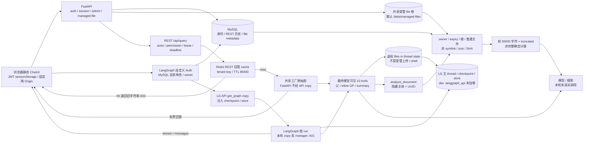

# Deep Data Agent 项目分析

> 当前复审：2026-10-27；固定源码 BASE：`main @ 3d4ac6dbb540d7f8a46430f3bc311c071d4ba438`。
> 本文为已批准 `review-project-modernization` 任务 5 的文档交付，不是代码修复、运行验收或生产批准。

**实施更新（同日，修复工作树）**：`repair-agent-graph-copy` 已修复 `REV-A01`，
将租约管理器纳入资源图显式构造合同。本机真实工厂、copy/with_config/重复复制、
已安装 API get_graph 四调用面及保护/存储回归 149 项通过，全量后端 601 项通过；
isort、发布契约与差异检查通过。后续本机真实 TCP HTTP 的 wait/stream/state、
取消及身份负控通过；模型/租约为替身，使用隔离 SQLite/inmem 和启动时 NumPy
初始化。代码提交 `8e552f3` 的 PR #1 四 Hosted Job 已成功，包含 Ubuntu
602 项后端回归与 Linux 镜像容器冒烟；随后本机受限 Linux 容器中当前源码
150 项复制/TCP 回归通过。再从修复提交重建本机五服务，新镜像 150 项回归、
空库/Redis canary/head 重启/已知旧库迁移通过，但实际工厂图 wait/stream 退出
发生身份 ContextVar reset 异常，取消租约未及时释放；浏览器显示测试答案，
对应 run 仍为 error，匿名入口/退出跳转丢失宿主端口。本机完整联调未通过，
独立资源已清理，生产仍 NO-GO。
见 [补验记录](../specs/repair-agent-graph-copy/validation.md)。
详见 [修复规格](../specs/repair-agent-graph-copy/spec.md)。
下文保留固定 BASE 的修复前复审快照；原 A/B 值、理由、反证及历史矩阵不反写，
复制依赖缺失的源码修复结论保持；新增部署阻断独立记录，先修复异步租约
上下文，再继续合计预算 `REV-A02`，前端认证跳转可并行修复。

**后续修复更新**：`repair-async-lease-context` 已将图执行、身份与 deadline
放入同一个受控 Task，关闭/取消等待清理，两种 Token reset 异常均不跳过释放。
本机全量 **619 项通过**，真实工厂 TCP HTTP 的 wait/stream、可信主体、
取消最终 `interrupted` 和 timeout 均验证单次释放。前轮部署精确依赖下 Linux
**194 项通过**，独立 Redis 的实际 HTTP 4 次取得/释放相符、最终 DB 为 0 个 key；
控制条件与源码
证据见 [本轮验收](../specs/repair-async-lease-context/validation.md)。
**部署重验更新（2026-10-28）**：`repair-static-auth-redirect` 已通过相对 Location
修复端口丢失并增加真实 HTTP CI 门禁。当前源码生产静态构建、前端四门禁、
新后端镜像 194 项、五服务及浏览器通过；正常 run 最终 success，取消为
interrupted，timeout 为 agent_timeout，6 次真实 Redis 租约取得/释放相符。
双用户/管理员/受管文件、两次 Redis 故障恢复及空库/head/known legacy 迁移通过；
条件、指纹与清理见[本轮部署验收](../specs/repair-static-auth-redirect/validation.md)。
本轮未提交、未验 Hosted，合计预算/未知 schema/一致恢复等生产门禁保持，
生产 NO-GO。前轮失败与下文 A/B 快照继续保留。

**当前门禁更新（2026-10-28）**：合计账本覆盖父子、摘要、SDK 重试及并行取消；
未知/漂移 schema 在启动写入前显式拒绝；三域停写备份和空目标恢复入口已实施。
`requirements.txt` 为传递依赖和跨平台 SHA-256 锁，API 升为官方 active minor
`0.16.8`。新锁独立 Windows **733 项通过，101.15 秒**；真实 Redis/TCP **20 控制例通过**，
租约取得/释放各 20、最终 0 key；真实 MySQL **20 控制例通过**。
实施 SHA `1910fdf` 的 run `40635353761` 四 Hosted Job 全部成功：
Linux 完整后端 **733 项**、135 个活动包匹配、新锁五服务及 Chromium 七项通过。
三域独立恢复实测 **31.757 秒**，确认写入丢失 **0**；六项损坏/缺失负控及
非空目标拒绝通过。最终文档提交自身的精确 SHA 结果由工作区根回执另行核对。
本机系统盘限制使新锁 Linux 镜像构建中止，不能把前轮镜像/浏览器结果代入。
执行记录见[运行时门禁](../specs/stabilize-delivery-baseline/validation.md)、
[预算门禁](../specs/enforce-aggregate-agent-budget/validation.md)与
[恢复门禁](../specs/prove-data-recovery/validation.md)。
以下 A/B 原值、固定 BASE 和历史裁定不反写；下一产品候选为受控分析切片。
人工快照不建立自动异地备份或生产 dev runtime 支持，生产 NO-GO 保持。

## 1. 整体判断

**架构可以保留，不需要全量重写。** 双入口、第一方身份、服务端当前角色、默认拒绝、
thread/run 与受管文件 owner、固定浏览器 Origin、UUID 文件引用、读取前完整性复核、
UTC ORM、有界脱敏日志、Redis 单飞恢复、浅 readiness 和现有发布门禁已有实际价值。
旧 P0 的源码修复没有被本轮预算、缓存或恢复问题推翻。

主要产品短板仍是**真实分析闭环未接通、真实效果证据不足**。
CSV/JSON 上传与文本预览已可达，但完整结构质量、确定指标、同源表/图/报告和用户取得产物
尚未形成可信闭环。安装 pandas、聊天 Markdown、示例图表或 state `write_file` 都不能代替它。
没有真实模型任务、费用和延迟数据，既不能断言效果好，也不能断言效果差。
复审基线 API `0.7.28` 的维护债、未锁传递依赖及父子/摘要漏账已由上文当前
实施及新锁部署门禁验证；生产运行时支持和自动异地备份仍需独立证据。
Python 3.12、Node 22 主版本无需只因年龄强升。

下一产品建议为[受控分析切片](roadmap.md#近期顺序)，须另行授权。
UI 行为、兼容矩阵、评测设计可并行；未知 schema 拒绝可独立修。
恢复/schema 只作为相应生产、不可重建持久数据的门禁，不锁住非敏感、可重建、隔离开发。
真实 owner、文件和有效资源限制不可由风险接受绕过。生产仍 **NO-GO**，
新锁实施 SHA 的 Hosted、未知 schema 拒绝及合成数据一致恢复已通过，
生产运行时、自动异地备份/灾难切换和真实效果运营仍无证据。
本机复制图、流退出和认证跳转的前轮独立验证保留原范围。

<a id="基线与证据层次"></a>
## 2. 基线与证据层次

### 当前基线

最近 runtime implementation 为 `1090c3ea0954e84cc2cb6b945ef8c3913393cec8`，
2026-08-21 08:08:20 UTC+8；HEAD 为同日 08:19:33 的治理提交。implementation 至 BASE
仅 7 个治理文件差异，无新增 runtime 实现。本轮任务 1 始末 HEAD 相同。
写作开始实际 `git status --short --branch` 为 `main...origin/main`、`M AGENTS.md`、
`M README.md`、`?? .trae/specs/review-project-modernization/`；这些既有改动保留。
已读 root AGENTS、当前 spec/tasks/checklist、固定 BASE 两份旧正式文档、已协调材料、
历史保留清单、catalog/evidence、A/B JSON/md 与必要 Agent 报告。

| 层次 | 已取得证据 | 不可替代的边界 |
| --- | --- | --- |
| 当前源码 | BASE 的双入口、身份/文件/资源/迁移/前端/CI 装配 | 代码存在不等于真实运行通过 |
| 本机安装 | 下表版本与 131 包、28 根依赖满足声明，`pip check` exit 0；前端 61 直接依赖声明/lock/install 差异 0 | 安装快照不是发布锁；Windows 不外推 Linux |
| 离线复核 | 领域审查及独立 A/B 的真实编译图、安装库/AST、内存模型/工具/lease/文件状态探针 | 不是真实服务 HTTP、DB 删除、Redis、浏览器或付费效果 |
| 本轮基线实际执行 | 基线 Agent 于 2026-10-27 15:23–15:37 UTC+8 执行下表门禁 | 不是用户给定数字，也不是本文作者/A/B重跑 |
| 历史验收 | 2026-08-21 及之前 implementation 本地/Hosted/容器记录，见[历史里程碑](roadmap.md#历史里程碑) | 不替代 BASE 或最终文档 exact SHA |
| 未验运行 | BASE Hosted、容器/Linux/HTTP、浏览器 E2E、MySQL 并发、生产 restore、真实模型/搜索/业务效果/费用/延迟 | unknown 保持 unknown，不由支持票补齐 |

### 环境与版本

| 对象 | 声明或锁 | 2026-10-27 本机安装/观察 |
| --- | --- | --- |
| Python | 3.12 镜像 major；28 根依赖仅 6 精确 pins，无传递 hash lock | 系统/venv 3.12.9 |
| Agent 栈 | API 固定 0.7.28；其他多项未锁 | DeepAgents 0.7.5；LangGraph 1.2.11；API 0.7.28；CLI 0.4.31；Python SDK 0.4.2 |
| LangChain/模型 | 根 requirements | LangChain 1.3.15/core 1.5.4/community 0.4.2/OpenAI adapter 1.4.3；openai 2.54.0；tavily 0.7.27 |
| 后端基础 | 根 requirements | FastAPI 0.141.1；SQLAlchemy 2.0.52；pandas 3.0.5；httpx 0.28.1；redis 8.1.0；PyMySQL 1.2.0；uvicorn 0.52.1 |
| 工具/安全 | 根 requirements | pytest 9.1.1；isort 8.0.1；Alembic 1.19.1；dotenv 1.2.2；bcrypt 4.0.1/Passlib 1.7.4；cryptography 46.0.7；jose 3.5.0；setuptools 75.8.0 |
| 其他根依赖 | 根 requirements | email-validator 2.3.0；multipart 0.0.32；tabulate 0.10.0 |
| 前端 | Next `^15.2.3`、React/DOM `^19.0.0`；lock 15.3.2/19.1.0 | 安装与锁一致；JS SDK 1.0.0、JS LangGraph 1.0.1、JS core 1.0.2、TS 5.7.3、ESLint 9.27 |
| Node/pnpm | Node `>=22.11.0 <23`、pnpm 10.5.1 | 默认 25.2.1/10.33.2 不符；门禁用已有缓存 22.22.2/10.5.1，未安装 |
| Docker | 五服务 Compose 定义 | CLI 29.4.1、Compose 5.1.3、Desktop 4.71.0.225177 有；`dockerDesktopLinuxEngine` pipe 缺，exit 1 |
| Hosted 查询 | 目标 SHA 四 Job | `gh` 缺，CommandNotFoundException，退出 N/A；没有绕过查询或安装 |
| utils | 独立依赖/空包元数据 | requests 2.34.2 有；moviepy、sshtunnel、pg8000 未安装；不构成主 Agent 能力 |

声明可查 [requirements](../../requirements.txt#L1-L28)、
[前端契约](../../agent_chatui/package.json#L10-L25)、
[前端版本](../../agent_chatui/package.json#L51-L82)；上述安装值是任务 1 记录，不声称作者重新安装/核验。
镜像 `python:3.12-slim`、`node:22-alpine`、`nginx:1.27-alpine`、`mysql:8.4`、
`redis:7-alpine` 为声明 tag，不是 resolved digest、SBOM 或已发现漏洞。

### 本轮门禁执行记录

均由基线 Agent 实际执行，以下成功项 exit 0；写作阶段不重跑。

| 命令/检查 | 实际结果 | 耗时 / timeout |
| --- | --- | --- |
| `python -m pytest` | 452 passed | 55.47s / 240s |
| `python -m pytest -q tests/test_migrations.py` | 8 passed | 4.62s / 90s |
| `python -m pytest -q tests/test_release_contracts.py` | 159 passed | 27.11s / 120s |
| `python -m isort --check-only data_agent tests scripts` | 通过 | 1.56s / 60s |
| `python scripts/check_release_contracts.py` | 通过 | 1.22s / 60s |
| `python -m alembic -c alembic.ini heads` | 唯一 `b6f4e8c2a9d1` | 1.66s / 60s |
| 缓存 Node/pnpm `typecheck` | 通过 | 36.66s / 120s |
| 缓存 Node/pnpm `lint` | 零警告 | 31.55s / 120s |
| 缓存 Node/pnpm `format:check` | 通过 | 14.47s / 120s |
| 缓存 Node/pnpm `build` | 静态 7/7、导出 3/3 | 171.08s / 300s |
| `docker compose --env-file NUL -f docker-config/docker-compose.yml config --no-env-resolution --quiet` | 安全静态解析通过；未读取真实 `.env` | timeout 35s |
| `git diff --check` | 当时通过 | timeout 30s |

基线初轮隔离器误拦 Windows asyncio 自管道/缺临时父目录已作废，修正后有效轮通过，
不改变源码。dotenv/插件/追踪/字节码禁用，外连与真实 dotenv 读取尝试为 0；
前端使用假公开配置。build 的 Next ESLint 插件识别提示不改变独立 lint 零警告。
基线 `.baseline`、`.next`、`out`、tsbuildinfo 已清理，next-env/tsconfig 哈希未变。
旧规格 12/12 完成（11 功能 + 1 audit，任务 382/382、checkpoints 288/288）。
当前 tasks 的 1–4 已勾、5–6 未勾；作者不修改状态。

## 3. 当前请求与数据流



图描述源码与本机安装装配，不表示 API copy 已成功或外部服务已运行。
`DEC-001` 决定 LangGraph 是主聊天历史，MySQL users/RBAC 是身份主数据；
REST sessions/messages 保留但不双写主聊天。`DEC-002` 使用自定义 Auth，不新增 REST 流式代理。
`DEC-004` 使用 MySQL owner metadata + 共享受管卷 + opaque UUID；
新 thread 仅保存 `__managed_file_v1__` 引用，历史 Base64 仅只读兼容。
虚拟 `write_file/delete` 不创建/删除受管上传字节，也不构成受管报告下载。
正常同容器 restart 可加载 dev 已落盘状态；recreate/remove 丢未挂载 layer，
约 10 秒多文件 flush 不保证事务性 10 秒 RPO。

装配证据：[双入口](../../langgraph.json#L1-L13)、
[导出图](../../data_agent/agent_graph.py#L1-L5)、
[图工厂](../../data_agent/services/agent_service.py#L294-L328)、
[原图包装](../../data_agent/services/agent_service.py#L206-L271)、
[REST cache](../../data_agent/services/agent_service.py#L403-L443)、
[前端主 stream](../../agent_chatui/src/providers/Stream.tsx#L29-L54)、
[共享卷](../../docker-config/docker-compose.yml#L36-L74)、
[dev 启动](../../docker-config/docker-compose.yml#L153-L168)。

### 业务链逐环核对

| 环节 | 当前真实能力 | 缺口 / 归属 |
| --- | --- | --- |
| 输入 | 有界 UTF-8 TXT/Markdown/CSV/JSON、owner UUID、格式/配额/整批事务 | signed CSV 受旧严格合同拒绝，C01 是决策，不是 bug |
| 结构质量 | CSV reader/json.loads 验证合法性 | 无 columns/types/NA/duplicate/完整行数/范围合同；R06 |
| 预览 | 完整字节读取后最多 20000 字符及 truncated | 领域 CSV/JSON 尾部 999 不可见、预览无 SHA；截断 JSON 是文本，不保证可解析 |
| 计算 | 自定义 search/document、框架虚拟 file/task/summary | 无完整数据白名单 profile/filter/group/aggregate 与结构化 result；R06 |
| 表/图 | 可表达聊天；AutoChart 硬编码样例 | 未接同一来源数值；F06/R07 |
| 报告 | 提示要求 polished 中文报告，可写聊天/虚拟 Markdown | 无 canonical 口径/参数/parser-tool/result/hash 来源；R07，不称完全不能写报告 |
| 用户取得 | owner thread/state 可取得虚拟文本；REST 输入预览/metadata | 无受管结果/图表/报告 endpoint；REST 仅最后 message；R07/F07 |
| 效果 | 工程/离线保护测试 | 真实正确性、引用、长上下文、费用与延迟未知；R08/R04 |

证据：[预览](../../data_agent/services/managed_file_service.py#L583-L614)、
[输入路由](../../data_agent/routes/managed_file.py#L114-L189)、
[工具注册](../../data_agent/tools/tool_manager.py#L14-L33)、
[示例图表](../../agent_chatui/src/app/test-chart/page.tsx#L17-L76)、
[图组件](../../agent_chatui/src/components/ui/ant-charts.tsx#L26-L80)、
[UI 事件容器](../../agent_chatui/src/components/thread/messages/ai.tsx#L18-L43)。
有容器组件但 `langgraph.json` 未注册 bundle、工厂未发 canonical 结果事件，不等于业务接通。

<a id="双维度裁定与追溯"></a>
## 4. 双维度裁定与追溯

### 计数与判级规则

48 主来源 = 18 AUD + 30 REV，另 3 历史追溯 = 51 唯一 ID；不是 48 bugs。
A/B 各覆盖 51，无 missing：102 票 100 true / 2 false。
主条目 47/0/1（2/2、完整 1/2、0/2），追溯 3/0/0，合计 50/0/1。
`supported` 计支持，不能用 `exists_current` 代票；null 不转 false。
支持关闭 `true/false` 不产生开放缺陷；AUD019 本轮支持“排除”不改旧历史存在性 0/2。
AUD004 两 false 否定完整 closed，两 exists=true 保留残余，不把它排除。
48 主来源去 5 个重复 canonical 分项为 43 裁定归属，不是开放风险/工程缺陷数。

P0/P1/P2/P3 沿获批 spec：直接泄露/越权/不可恢复损失或发布阻断；重大边界失效/不一致/
不可用；有受控绕行的维护/恢复/业务限制；低风险改善。机会/开放决策不赋工程 P。
下表是作者协调最终裁定；A/B 七字段及原 reason/counterevidence 在[独立原值](#独立原值)，
不把最终 P 写回 A/B。每条后续验收都是未来要求，不是本轮已通过。

### 历史 AUD 当前裁定

| 正式 ID / raw | 当前最终状态 / 级别条件 | 影响、理由与最小证据 | 建议 / 依赖 / 验收与去向 |
| --- | --- | --- | --- |
| AUD-001 / AUD001 | 历史缺陷源码关闭 | 身份/current role/default deny/thread owner/tenant key 在；[Auth](../../data_agent/security/langgraph_auth.py#L25-L75)。新预算不重开旧越权 | 保持两入口双用户/admin/thread/run/history/state/copy/cache 拒跨 owner；DEC-001/002，归已完成 tenant-boundaries 的回归 |
| AUD-002 / AUD002 | 历史缺陷源码关闭 | UUID+隐藏主体，读取前根/普通文件/size/SHA；[工具](../../data_agent/tools/document_analysis.py#L29-L65) | 保持 path/伪主体/跨 owner/symlink/漂移读取前拒绝；DEC-004，归已完成 file-ingestion 回归 |
| AUD-003 / AUD003 | 历史缺陷源码关闭 | 固定 Origin/JWT sessionStorage/旧 Key 只清；[配置](../../agent_chatui/src/config/index.ts#L1-L14) | 恶意 URL/相似域/redirect 不收 JWT，401/logout 清理、403 符合合同；前端回归/DEC-002，归 tenant-boundaries |
| AUD-004 / AUD004 | 部分修复；同步 Redis 残余 P2 | 主 await ainvoke 已修；async lease/限流内同步 IO；[lease](../../data_agent/services/agent_lease.py#L231-L252)、[释放](../../data_agent/services/agent_lease.py#L458-L477) | 有界隔离/异步 Redis，保留 recovery/scope；慢 IO 不阻 timer/deadline，cancel 单释放、不缓存失败；`isolate-async-redis-protection`。预算唯一归 A02 |
| AUD-005 / AUD005 | 历史缺陷源码关闭 | 有界上传/UUID，无新 Base64；[上传](../../data_agent/services/managed_file_service.py#L368-L399) | 两入口选择/拖放/粘贴/超界整批无副作用；owner/DEC-004，归 file-ingestion；B02 不重开旧无界状态 |
| AUD-006 / AUD006 | 开放技术债 P2 | 无传递 hash lock、包/资产分裂、浮动引用；[声明](../../requirements.txt#L1-L28) | D02/D03/R02/R05/AUD021 只作分项；DEC-005 输入；仓外双入口/迁移、同锁两次一致/漂移拒绝/Linux回归；交付基线子迭代 |
| AUD-007 / AUD007 | 条件 P1 确定缺陷开放 | users 存在无版本的未知/漂移库会 stamp；[代码](../../data_agent/config/database.py#L108-L115) | 完整指纹在 stamp/DDL 前 fail-closed；known legacy 合同；缺表列/类型/索引/FK/约束 DB 不变、已知无损；`reject-unknown-schema`，生产另需 RR-001 |
| AUD-008 / AUD008 | 历史缺陷源码关闭 | 单飞/退避/成功重置存在；[恢复](../../data_agent/services/redis_recovery.py#L154-L189) | 断开/连续失败/恢复/再故障无需重启；RR-006；归 resource-use 回归，真实 canary 另验 |
| AUD-009 / AUD009 | 历史缺陷源码关闭 | live/ready 分离、组件浅验；[ready](../../data_agent/readiness.py#L85-L130) | 故障 ready503/live200/恢复200、脱敏无付费探针；AUD-007 另治结构；归 resource-use 回归 |
| AUD-010 / AUD010 | 开放缺陷 P2 | REST all 无界、主 threads100 无继续；[REST](../../data_agent/services/session_service.py#L34-L46)、[threads](../../agent_chatui/src/providers/Thread.tsx#L22-L33) | 主线程增量/失败恢复优先，REST 独立有界；DEC-001/owner；cursor/页限/索引/并发稳定，`paginate-session-history`，吸收 AUD013；checkpoint10 非消息10 |
| AUD-011 / AUD011 | 机制关闭；本 SHA 运行未知 | current source build/Container Smoke/清理在；[CI](../../.github/workflows/release-readiness.yml#L104-L124) | exact-SHA 四 Job/五服务/失败清理实际取证；Engine/Hosted 条件；归 release-gates，不能以 FastAPI restart 证明主历史恢复 |
| AUD-012 / AUD012 | 开放技术债 P2 | audit/lease 复用 JWT key，轮换拆身份分组条件；[audit](../../data_agent/observability/audit.py#L10-L23)、[lease摘要](../../data_agent/services/agent_lease.py#L207-L220) | 用途/版本分离和 active lease 连续性；密钥合同/AUD018；JWT滚动不改归属/拆lease、不可互用无明文；`separate-identity-digests` |
| AUD-014 / AUD014 | 历史缺陷源码关闭 | Docker COPY 有迁移资产；[镜像](../../data_agent/Dockerfile#L6-L20) | 保持 allowlist/current image empty/head/known legacy/缺件负控；归 release-gates；D02 包缺件不是此复发 |
| AUD-015 / AUD015 | 历史缺陷源码关闭 | cached+others+exclude-standard 替代前缀；[扫描](../../scripts/check_release_contracts.py#L312-L371) | 新目录 canary 拒绝、只报规则/path/line；RR-002 历史另治；归 release-gates，不称未知秘密全清 |
| AUD-016 / AUD016 | 开放条件缺陷 P2；MySQL并发未测 | 缺锁内 actor/admin>=1 不变量；[admin](../../data_agent/services/admin_service.py#L60-L85) | 专用两连接交叉降级最多一成功、陈旧actor拒绝、死锁重试稳定、保留人工bootstrap；`preserve-admin-continuity`。可恢复不升P1 |
| AUD-017 / AUD017 | 开放缺陷 P2；当前 bcrypt/Passlib | 72 UTF-8后缀互认、NUL/4097异常；[verify](../../data_agent/services/auth_service.py#L62-L68) | 注册/登录统一 byte/NUL/error，批准旧hash迁移；71/72/73/Unicode/long非500、不后缀互认、重哈希/重置明确；`normalize-password-boundaries` |
| AUD-018 / AUD018 | 开放隐私债 P3；先有Redis读权 | 无key截断SHA可枚举低熵ID/IP；[键](../../data_agent/services/rate_limit_service.py#L130-L140) | 独立域HMAC/最小Redis权限；轮换合同；无key不可复算、窗口不漂移、无原始映射；identity-digests限流子面，非匿名泄漏/撤销 |
| AUD-020 / AUD020 | 开放行为测试债 P2 | 四静态门禁非第一方workflow suite；[scripts](../../agent_chatui/package.json#L16-L25) | 离线组件/集成+关键E2E；F01-F03/B03/F07风险目标，HITL激活才纳入；本地/CI正反复跑无外连；`verify-chat-workflows` |

旧18当前：9保持关闭、原8仍开放、AUD004部分修复/残余开放；
旧 ID 开放或残余归属为 1 P1 / 7 P2 / 1 P3，不包括新 REV/RR/DEC，不重计 A02。
这不改 2026-08-21 的10关闭/8开放历史。

### REV 当前裁定

| 原 ID → canonical | 最终类型 / 状态 / 条件 | 影响与最小证据 | 建议 / 依赖 / 后续验收与去向 |
| --- | --- | --- | --- |
| REV-A01 → 同ID | 本机组合确定缺陷，主run copy条件P1 | copy/with_config/get_graph丢manager；[构造](../../data_agent/services/agent_service.py#L258-L271)。原图四面通过 | 窄修重建，保留CompiledStateGraph/checkpoint/store；冻结组合；原/copy/config/get_graph四面调用/owner/预算/cancel/单lease；`repair-agent-graph-copy`，Linux/HTTP另验 |
| REV-A02 → 同ID | 默认task/summary合计预算缺陷 P2 | 默认10model/20tool/childrec9999；[父限额](../../data_agent/services/agent_service.py#L294-L326)；详见下节 | run-scoped并发安全ledger/子递归；LG验收依赖A01；第9model/13tool执行前拒绝、并行/summary/retry/两owner/cancel无副作用；`enforce-aggregate-agent-budget` |
| REV-A03 → 同ID | REST current合同下条件P2债；快照可转决策 | TTL86400回答cache无文件依赖；[hit](../../data_agent/services/agent_service.py#L403-L443)；主ChatUI不使用 | 先定current/快照，禁受管引用cache或绑定owner/UUID/SHA/expiry复核；文件合同；active/delete/expiry/hash/越权/普通query/cancel验；`decide-file-answer-semantics` |
| REV-B01 → 同ID | unlink失败/commit前crash缺陷 P2 | metadata先删、孤儿无持久定位；[delete](../../data_agent/services/managed_file_service.py#L529-L554) | tombstone/幂等对账；owner/root/F07，持久文件RR-001；重启定位重试/账实一致不误删；`recover-file-cleanup` |
| REV-B02 → 同ID | 条件风险/开放决策，exists=null；若RR时序成立P2 | 锁前快照可能漏aggregate，RC反证；[事务](../../data_agent/services/managed_file_service.py#L378-L409) | 专用MySQL两连接先裁定RR/RC，不预设修复；近数量/字节/重复/过期/等待/重试不超界无部分写；`validate-quota-isolation` |
| REV-B03 → 同ID | allowed跨Origin early-error缺陷 P2 | 413无CORS实证，429/503待验；[顺序](../../data_agent/agent_server.py#L50-L63) | CORS外包稳定错误/ID，不放宽Origin；400/413/429/503/预检正反；`expose-stable-cross-origin-errors`，UI测试可并行 |
| REV-F01 → 同ID | active resumable Cancel缺陷 P2 | stop不等server cancel确认，Provider未接storage；[Provider](../../agent_chatui/src/providers/Stream.tsx#L29-L48) | run ID/结果追踪；SDK合同/A01解锁HTTP；creation/active/disconnect/switch/fail/retry状态、预算内停/释放无串thread；`confirm-server-cancel` |
| REV-F02 → 同ID | incomplete/partial/out-of-order工具结果缺陷 P2 | 伪成功模型上下文/漏补重复；[函数](../../agent_chatui/src/lib/ensure-tool-responses.ts#L6-L30) | 按tool_call_id+真实状态；F01/协议；normal/multi/partial/fail/cancel不伪造成功或重复漏项；`reconcile-tool-results` |
| REV-F03 → 同ID | 编辑附件历史缺陷 P2 | 新分支只提交文本丢引用；[编辑](../../agent_chatui/src/components/thread/messages/human.tsx#L50-L85) | 保留引用或显式移除；owner/checkpoint/F07；text+file/file-only/expired/deleted/fail/retry明确集合、无Base64；`preserve-edit-attachments` |
| REV-F04 → 同ID | 未激活债；Inbox schema启用时条件P2 | 先报成功清决策，async error入state；[submit](../../agent_chatui/src/components/thread/agent-inbox/hooks/use-interrupted-actions.tsx#L88-L108) | 激活才按accepted/error/finish，失败保留/幂等；真实schema/SDK；单/批量/cancel/retry不提前accepted；`activate-inbox-safely`，默认不启动 |
| REV-F05 → 同ID | 旧指南/人工脚本技术债 P2 | 旧表单/代理/basepath/全树权限误导；[脚本](../../agent_chatui/start.sh#L1-L8) | consumer盘点/DEC-005后统一支持指南；另一维护者复现、无旧误导/不必要权限；`align-supported-frontend-guidance`，不执行脚本 |
| REV-F06 → 同ID | 业务机会，无P | AutoChart样例非文件分析，AVA类型非已证错误；[组件](../../agent_chatui/src/components/ui/ant-charts.tsx#L26-L45) | 复用同canonical schema/metric/unit/fileversion；R06/R07；表图报告同值/空值单位范围失效明确；`extend-canonical-analysis-output` |
| REV-F07 → 同ID | 文件生命周期开放决策，无P | draft内存/历史无liveness；[引用](../../agent_chatui/src/lib/managed-file-reference.ts#L25-L60) | 定refresh/switch/logout/leave/upload/sendfail/expiry/delete；F03/B01，持久化才RR-001；重试不丢/不串owner、失效不假分析；文件语义迭代 |
| REV-D01 → RR-001 | 持久主历史条件P1恢复风险，容器未知 | dev .langgraph_api未挂；正常restart可读盘；[dev](../../docker-config/docker-compose.yml#L153-L168) | 分类/支持runtime/RPO-RTO/DEC-001；thread/checkpoint+身份+file metadata/bytes/version独立restore；`prove-data-recovery`，非全开发锁 |
| REV-D02 → AUD-006 | root包契约缺陷分项 P2 | discovery只utils/空依赖/缺资产；[setup](../../setup.py#L1-L8) | 权威metadata/resource/批准模块；DEC-005/锁；仓外install双入口/迁移/ready不借cwd；`align-package-release-contract` |
| REV-D03 → AUD-006 | 可重复交付债分项 P2 | 6pins/无hash/镜像Actions浮动；[依赖](../../requirements.txt#L1-L28) | runtime/dev分离/hash/digest/SHA显式更新；权威声明/目标组合；干净Linux两次清单一致/漂移拒绝；包与锁子迭代 |
| REV-D04 → 同ID | 仅挂载外override条件P2配置缺陷 | env改根、target固定；默认/挂内子路径反证；[volume](../../docker-config/docker-compose.yml#L36-L74) | 启动前拒不兼容根或同步批准target；DEC-004/结构；两入口默认/批准非默认共享/recreate保留，未批准写前拒；`validate-file-storage-root` |
| REV-D05 → 同ID | marker验证债 P2 | 字符串不证明可达/层级；[contract](../../scripts/check_release_contracts.py#L1008-L1033) | 关键结构+窄行为/负变异，不全重写；Agent/卷；注释/死码/错层/未接middleware仍有marker时失败；`strengthen-critical-contracts` |
| REV-D06 → DEC-005 | 遗留归属开放决策，无P | 仓内未导入但root包含，不证明仓外无人用；[声明](../../utils/README.md#L1-L2) | consumer/owner后隔离/独立治理/纳入；D02/F05；包镜像只批准模块、有通知/责任，无owner不纳入；交付基线决策 |
| REV-C01 → 同ID | signedCSV业务安全合同，无P | 严格拒=,+,-,@符合[旧spec](../specs/isolate-file-ingestion/spec.md#L26-L27)，JSON负值可绕行 | 无批准保持；有需求才finite grammar/长度指数精度、导出转义另验；数值/公式/space/tab/quoted/整批正反不改值；`decide-signed-csv-contract` |
| REV-R01 → 同ID | 按部署条件必要补丁建议，无无条件P | Next15.3.2落49005范围；Nginxstatic无Node处理器；见来源S7–10 | 模式/公告/lock/行为矩阵；静态frozen/type/lint/format/build/Nginx深链与server暴露另验；`patch-exposed-frontend-runtime`，floor非latest |
| REV-R02 → AUD-006 | 稳定迁移建议，运行未验，无新增P | API EOL，changelog/索引时点不同；metadata非完整兼容 | API/CLI/SDK/crypto/inmem矩阵/native/Linux/owner/stream/A01/A02；双入口/restore/卷全验，暂不迁0.17rc；`validate-runtime-compatibility` |
| REV-R03 → REV-A02 | 分层能力/预算策略说明，不另计缺陷 | 最终10工具无execute；factory/dispatch另层；下节保留旧capture | 精确inventory/backend/middleware；安装组合/A02/R02；父子summary/retry/并行有界、身份cancel保留；预算迭代附带清单 |
| REV-R04 → 同ID | 模型开放决策，保留baseline，无P | thinking reasoning回传/参数协议不同，未证明turbo-preview坏 | 协议适配/taskset/R08后人工比较；多轮tool+reasoning/stream/error/usage及真实正确性/延迟消耗；`compare-model-protocol`，无授权暂缓 |
| REV-R05 → AUD-006 | runtime维护分项，无新增P | Python3.12 security/Node22 LTS可保major；patch/digest未知 | 支持major上显式patch/distro/digest；native/TLS/目标组合；发行/平台/安装与双入口/迁移/静态/容器复验；兼容子迭代，不永久freeze |
| REV-R06 → 同ID | 受控计算机会，无P | 截断preview不是完整结构/指标 | 完整ownerCSV/JSON→quality→批准白名单指标；owner/file/有效A02/C01按需；quote/NA/dup/type/tail>20k独立参考+硬资源；`deliver-controlled-analysis-slice` |
| REV-R07 → 同ID | 同源可取得产物机会，无P | 聊天/虚拟Markdown无canonical受管结果 | 单一result表/解释/取得摘要，再扩图/报告；R06/F07，持久化才RR-001；UUID/SHA/范围参数单位精度/版本/hash/time/warning一致，双owner/cancel/retry/删除；slice及output扩展 |
| REV-R08 → 同ID | 效果评测机会，无P | 452/替身非任务成功率 | 非敏感固定taskset/hash/独立参考/失败分类/版本；设计并行，真实调用人工批准；实际success/first-token/total/calls/retry/token/bill才填数；`establish-analysis-evaluation` |
| REV-R09 → 同ID | 可选沙箱决策，暂缓，无P | StateBackend非shell、utils exec非runtime | 白名单不能满足重要已批任务且收益明确才另spec；RR-004重评；无host/socket/secret/network、CPU/memory/disk/time/TTL/cancel/逃逸/owner负控；`trial-isolated-execution` |
| REV-R10 → 同ID | 可选框架能力，暂缓，无P | GP已inline awaited；Todo/Skills/MCP/memory/HITL未配/未见 | 每次一能力task-benefit/R08/A02/权限网络保留审批；收益>复杂度/可退；`trial-one-agent-capability`，无实证不成套启用/采购 |

### 历史三追溯与唯一映射

| 原正式 / raw | 最终归属 | 当前理由 / 后续 |
| --- | --- | --- |
| AUD-013 / AUD013 | AUD-010 | 分页仍在；threads>100继续/失败恢复随分页验，不单计 |
| AUD-021 / AUD021 | AUD-006 | 浮动引用仍在；digest/SHA/显式更新随锁兼容验，不单计 |
| AUD-019 / AUD019 | null / excluded | localhost可覆盖开发值，不造修复；浏览器可达/防误暴露归RR-003/DEC-003 |

正式 `AUD-001` 与 raw `AUD001` 是别名，raw ID不改；REV不重编号。
D02/D03/R02/R05/AUD021→AUD-006；R03→A02；D01→RR-001；D06→DEC-005。
A01独立，不被兼容债吞并；AUD004同步Redis独立，不把预算再次计在该条。
RR/DEC 的唯一后续映射见[风险决策](roadmap.md#风险决策)，全来源去向见[映射与子迭代](roadmap.md#映射与子迭代)。

<a id="关键实证反证与覆盖"></a>
## 5. 关键实证、反证与覆盖

### Agent 装配事实

以下均是本轮已经完成的离线探针，不是作者重跑：

| 实证来源 / 控制 | 实际观察 | 结论限制 |
| --- | --- | --- |
| A01 A实际类AST+真实copy | 原图noop成功；copy/with_config缺manager，ainvoke AttributeError | A不是完整服务装配/HTTP；A severity=null |
| A01 B真实编译图+安装get_graph AST非factory分支 | 原图 invoke/ainvoke/stream/astream 四面成功；copy/update、with_config、get_graph各四面均失败；checkpoint/store注入成功 | 错误：`'ResourceBoundedAgentGraph' object has no attribute '_agent_lease_manager'`；在模型/取lease前；B条件P1不外推Linux/HTTP |
| A02 领域/A/B默认图 | parent2+child8=10model；child19+task1=20tool；parentrec25/childrec9999 | 默认task/summary条件；不是付费次数、发生率或无限run |
| A02 public/private | A public返回未显示私有父计数；B recorder为model2/tool1；领域root state2/1 | 不把B的2/1补入A public null/省略值 |
| A02 摘要控制 | 仅收紧limit1；summary1+parent1=2，父count1，有summary event | 不是默认8的已实测摘要溢出轮次 |
| A02 B重复安装控制 | 每图8/12，顺序两task：父3+子10=13model、child8+task2=10tool | 不同回复序列/控制例，不是默认图，也不是共享ledger修复 |
| B旧R03/AUD004 | 原11model、八个主体17、main_counts空、final parent done 保留 | 新10/13不是更正旧11，不平均或篡raw |
| 父负控/身份/取消 | 父13tools执行0、AgentToolBudgetExceededError；主体17非999/request ID传播；await child/summary deadline及child显式cancel，各lease1/1/0 | 主预算、owner、deadline仍有效；MemoryLease不证明慢Redis抢占、任意同步IO硬停或收费撤销 |
| A03领域/A | 失效文件替身后同答案，graph1/TTL86400 | 非真实DB删除/expiry E2E |
| A03 B | active/deleted/expired/hash_drift同答案/graph1；actor17/18键不同，18进图后AgentInvocationError，denied缓存前AuthorizationDeniedError，lease6/6/0 | 实现缺依赖；current/快照产品条件，非跨tenant或主ChatUI泄漏 |
| 预览领域 | CSV/JSON各20000字符、truncated=true、尾部999不见、无SHA | 完整计算与来源机会，不是合法预览违反旧spec |

领域最终有效 command `4e6bb0536d69b1e0d8f951abf9f2b4d4` exit0，
探针源码SHA256 `AD01258250184D7C0246EC12E62234D8CF276D3C30671841ADB8F112F9215CDF`。
B补充有效 command `eb7acb681bc4ec0d8faa93fdc899c34b` exit0，
探针SHA256 `931803F2BED379159B1EB902F43FD979257655794D9990D837A830A459AE992C`。
作废隔离/引号/初始化轮不计结果；无模型/搜索调用、真实.env/data/logs或服务连接。
这些指纹是取证来源身份，不是最终文档验收SHA，也不依赖临时文件链接。

安装库最小定位：[API copy](../../.venv/Lib/site-packages/langgraph_api/graph.py#L234-L250)、
[Pregel重建](../../.venv/Lib/site-packages/langgraph/pregel/main.py#L922-L931)、
[GP构造](../../.venv/Lib/site-packages/deepagents/graph.py#L750-L795)、
[子图await](../../.venv/Lib/site-packages/deepagents/middleware/subagents.py#L529-L596)、
[model计数](../../.venv/Lib/site-packages/langchain/agents/middleware/model_call_limit.py#L168-L200)、
[summary直调](../../.venv/Lib/site-packages/langchain/agents/middleware/summarization.py#L856-L890)、
[recursion默认](../../.venv/Lib/site-packages/langchain/agents/factory.py#L1829-L1857)。
库链接只是当前安装导航；本节已保留关键观察，换环境不以新版库替代本机证据。

### 工具与上下文层次

本轮默认最终模型可见十工具：
`analyze_document`、`internet_search`、`task`、`ls`、`read_file`、`write_file`、
`edit_file`、`delete`、`glob`、`grep`。两custom、一个GP task、七virtual file；
无 `execute/write_todos/compact_conversation`。B新sync/async bound清单与领域清单一致。
factory注册11包含execute，filesystem dispatch8也包含execute，是另层，不改原capture。

B旧构造capture原顺序为：

```json
["internet_search","ls","read_file","write_file","edit_file","delete","glob","grep","execute","task"]
```

这是当次factory捕获，不是最终模型可见清单。StateBackend execution=false、无execute方法，
不支持SandboxBackendProtocol；直接dispatch stub `status=error / Execution not available`。
[能力过滤](../../.venv/Lib/site-packages/deepagents/middleware/filesystem.py#L2992-L3019)在sync/async
bind之前，虚拟files属于thread state，不可因此读宿主路径、执行shell或删除受管bytes。
GP是inline awaited，未配remote AsyncSubAgent/Skills/MCP/跨线程memory/HITL；
无profile摘要fallback为170000 tokens/6消息，profile策略85%/10%。
GP标准提示与app中文研究提示不同的真实效果、第三方模型上下文适配尚未评测。

### 已审查的保留面与无独立问题面

本节复用任务2已完成覆盖，不重复六方向审查。闭合证据仍有部署适用范围。

| 覆盖对象 | 保留结论 / 最小定位 | 不新增缺陷的理由 / 相关归属 |
| --- | --- | --- |
| 身份/RBAC/owner/错误 | [服务端主体](../../data_agent/services/agent_service.py#L168-L203)、[文档身份](../../data_agent/tools/document_analysis.py#L16-L65) | 未见子图改owner、匿名旁路复发；A01不可用不等于授权失效，AUD001/002保持关闭 |
| JWT/fixedOrigin | [Thread](../../agent_chatui/src/providers/Thread.tsx#L22-L33)、[Stream](../../agent_chatui/src/providers/Stream.tsx#L29-L54) | 通用client接url不等当前调用可改Origin；LangGraph403保身份符合合同 |
| 文件安全 | [有效性](../../data_agent/services/managed_file_service.py#L510-L580) | root/non-symlink/普通文件/size/hash存在；B01/B02/D04不泛化任意路径复发 |
| async工具/生命周期 | [search](../../data_agent/tools/search.py#L168-L204)、[同步工具executor](../../.venv/Lib/site-packages/langchain_core/tools/structured.py#L60-L70) | search async/document executor；取消await不保证已开始同步IO硬停，AUD004限定残余 |
| Redis恢复/健康 | [recovery](../../data_agent/services/redis_recovery.py#L154-L189)、[ready](../../data_agent/readiness.py#L85-L130) | 单飞退避/分级策略在；低成本fail-open非永久降级，head非完整schema |
| ORM/可观测/诊断 | [共享模型](../../data_agent/models/user.py#L1-L40)、[审计](../../data_agent/observability/audit.py#L10-L23) | UTC/shared metadata/脱敏有价值，不要求先建OTel/SIEM，RR-005限长期审计 |
| 迁移/发布 | [stamp](../../data_agent/config/database.py#L108-L115)、[CI](../../.github/workflows/release-readiness.yml#L104-L124) | empty/known legacy/head测试不是陌生库证明；CI机制已修但本SHA运行未知 |
| 静态前端/图表 | [static](../../agent_chatui/next.config.mjs#L4-L20)、[demo](../../agent_chatui/src/app/test-chart/page.tsx#L17-L76) | static公开样例不构成越权；type cast非坏图证据，server CVE不套Nginx |
| 包与utils | [root包](../../setup.py#L1-L8)、[用途](../../utils/README.md#L1-L2) | 主app无导入不证仓外无consumer；遗留exec非当前Agent工具，DEC-005决定发布归属 |
| 限额测试/真实效果 | [资源tests](../../tests/test_agent_resource_limits.py#L186-L227)、[并发tests](../../tests/test_agent_concurrency.py#L610-L641) | mock工厂/单middleware有价值，未覆盖真实copy/默认GP/summary；R08不是pytest成功率 |

<a id="技术资料与现代化选择"></a>
## 6. 技术资料与现代化选择

全部来源获取/复用日为 **2026-10-27**，来自任务3/主Agent及A/B已取得材料；
本文作者未联网、搜索或安装。S1/S10主Agent再次实取，A在线7页/metadata、B在线9页；
其他行按协调复用标示，不冒称每个验证者重取。来源发布日期/更新日未提供时明确“未注明”，
不以获取日代替发行日。同vendor多页计单源，NVD复述不计第三独立来源。
这是具体官方事实与候选方案，不声称三个独立来源证明普遍趋势或已量化收益。

| 组 / 已取得来源 | 来源日期 / 获取日 | 适用版本、项目路径与最小选择 | 单源 / 冲突 / 未验边界 |
| --- | --- | --- | --- |
| S1 [Server changelog](https://docs.langchain.com/langsmith/agent-server-changelog)、[0.16.2 metadata](https://pypi.org/pypi/langgraph-api/0.16.2/json)、[索引](https://pypi.org/pypi/langgraph-api/json)、[原wheel metadata](https://files.pythonhosted.org/packages/b1/1d/757b9d254ac944ad40048d5b0776add4c45c37f82283b5ecfe182978dbf6/langgraph_api-0.16.2-py3-none-any.whl.metadata) | 0.16.2 upload 2026-10-20T02:08:23.836132Z；0.16.6 upload 2026-10-23T17:05:31.782664Z；获取10-27 | 当前API0.7.28；requirements/图/Auth；稳定兼容矩阵而非改单行 | 同项目单源；changelog stable0.16.2/0.17rc4，早PyPI0.16.6/B新0.16.7不同抓取；不称任一latest；更高版完整changes未知 |
| S2 [CLI](https://docs.langchain.com/langsmith/cli) | 页面日期未注明；获取10-27 | CLI0.4.31本地metadata范围API>=0.5.35,<1；langgraph.json/Compose | 官方单源；可疑CLI wheel metadataURL不引用；允许范围非运行兼容 |
| S3 [SDK](https://pypi.org/project/langgraph-sdk/)、[streaming](https://docs.langchain.com/langsmith/streaming) | 发布页日期未归档；获取10-27 | 当前Python0.4.2/JS1.0.0；候选Python0.4.8；stream/cancel合同 | vendor单源，SDK更新不证明事件/取消/owner回归 |
| S4 [DeepAgents0.2.0](https://pypi.org/project/deepagents/0.2.0/)、[current](https://pypi.org/project/deepagents/)、[factory](https://reference.langchain.com/python/deepagents/graph/create_deep_agent) | 文档current0.7.29/历史0.2.0，发布日期未归档；获取10-27 | 安装0.7.5；agent_service/默认tools/GP | 单源版本差；0.2 Todo/current网页不倒推本机10工具清单 |
| S5 [LC v1](https://docs.langchain.com/oss/python/releases/langchain-v1)、[middleware](https://docs.langchain.com/oss/python/deepagents/middleware)、[structured output](https://docs.langchain.com/oss/python/langchain/structured-output) | 页日期未注明；获取10-27 | 当前LC1.3.15/DA0.7.5；图预算/结果schema | 同vendor单源；新能力非项目已接入或运行正确证明 |
| S6 [OpenAI adapter](https://docs.langchain.com/oss/python/integrations/chat/openai)、[Kimi模型](https://platform.kimi.com/docs/api/models-overview)、[thinking](https://platform.kimi.com/docs/guide/use-thinking-models)、[JSON](https://platform.kimi.com/docs/guide/use-json-mode-feature-of-kimi-api) | 页日期未注明；获取10-27，B涉及K3.1/K2.7-code/K2.6 | 现kimi-k2-turbo-preview/ChatOpenAI；config/agent_service；协议试验后人工比较 | 双方协议交叉非效果三独立证据；reasoning_content/temperature/max_tokens新要求不证现baseline坏 |
| S7 [Next12月更新](https://nextjs.org/blog/security-update-2025-12-11)、[React12月3日](https://react.dev/blog/2025/12/03/critical-security-vulnerability-in-react-server-components)、[React后续](https://react.dev/blog/2025/12/11/denial-of-service-and-source-code-exposure-in-react-server-components) | 2025-12-03/12-11，后续updated2026-01-26；获取10-27 | lockNext15.3.2/Reactclient19.1.0；dev/server RSC模式另验 | Next15.3.8旧表与后续Next15.3.9/server-dom19.1.5 floor时点不同；floor非latest/全漏洞最终安全目标；B后续floor协调复用，非B重取 |
| S8 [49005](https://vercel.com/changelog/cve-2025-49005)、[NVD](https://nvd.nist.gov/vuln/detail/CVE-2025-49005) | 官方2025-07-03；获取10-27 | >=15.3.0,<15.3.3，特定修复15.3.3；AppRouter middleware redirect/cache | 官方单源/NVD复述；不套Nginxstatic或所有Reactclient；GH advisories缺口 |
| S9 [static export](https://nextjs.org/docs/app/guides/static-exports)、[升级16](https://nextjs.org/docs/app/guides/upgrading/version-16) | 文档日期未注明；获取10-27 | next.config/Docker/Nginx；保static/basepath/fixedOrigin回归 | vendor单源；server/dev与static分开，16可选迁移非本轮命令 |
| S10 [支持政策](https://nextjs.org/support-policy)、[Next15发布](https://nextjs.org/blog/next-15) | release2024-10-21；获取10-27 | 表16 Active/15 Maintenance；前端锁与支持目标 | 同页两年=2026-10-21早于10-27，与表冲突；不任选确定EOL或完全受支持 |
| S11 [Python状态](https://devguide.python.org/versions/)、[PEP693](https://peps.python.org/pep-0693/)、[镜像](https://hub.docker.com/_/python) | 状态Last updated2026-05-27；获取10-27 | 3.12 security计划至2028-10；Dockerfile保major/评估patch | 官方计划单源；3.12.15精确发行/Windows binary未全核，不伪造新patch；digest/漏洞未知 |
| S12 [Node状态](https://nodejs.org/en/about/previous-releases)、[22.23.4页面](https://nodejs.org/en/blog/release/v22.23.4)、[镜像](https://hub.docker.com/_/node) | 列表/公告日期差1天，精确日未归档；获取10-27 | Node22 LTS；项目22.x契约，门禁22.22.2可保 | 官方单源；精确EOL/GH schedule未取，22.23.4页引用不等本轮确认新patch发行；digest/SBOM未知 |
| S13 [Docker构建](https://docs.docker.com/build/building/best-practices/)、[Nginx下载](https://nginx.org/en/download.html) | 页日期未注明；获取10-27 | 镜像/Actions固定digest/SHA伴显式更新 | 各自事实单源非安全共识；平台/native/TLS/实际漏洞未知 |
| S14 [backends](https://docs.langchain.com/oss/python/deepagents/backends)、[sandboxes](https://docs.langchain.com/oss/python/deepagents/sandboxes) | 页日期未注明；获取10-27 | StateBackend当前虚拟文件；R09白名单不足才隔离试验 | vendor单源；LocalShellBackend非沙箱，不恢复hostexec/采购 |
| S15 [pandas.read_csv](https://pandas.pydata.org/docs/reference/api/pandas.read_csv.html) | 文档日期未注明；获取/复用10-27 | 当前pandas3.0.5；受控完整ownerCSV/JSON parser/质量 | 官方单源解析合同非业务验收；[已获取分析示例](https://docs.langchain.com/oss/python/deepagents/data-analysis)仅方案参照 |
| S16 [evaluation](https://docs.langchain.com/langsmith/evaluation-concepts)、[test](https://docs.langchain.com/oss/python/langchain/test) | 页日期未注明；获取/复用10-27 | R08分工程/协议/真实任务，固定taskset独立参考 | vendor单源方法，不证明本项目效果/费用/延迟；无需买平台 |
| S17 [durable execution](https://docs.langchain.com/oss/python/langgraph/durable-execution) | 页日期未注明，S1 rc事实另校准；获取10-27 | drain仅0.17rc+graph>=1.2.15；replica handoff另需Postgres+flag | 当前API0.7.28/graph1.2.11/dev不满足；泛>=1.2无效，升级非持久化批准 |

API0.16.2 metadata 要求 crypto>=50、SDK>=0.4.4、graph>=0.4.10,<2、
checkpoint>=3.0.1,<5、inmem>=0.36.0.dev0,<0.37.0.dev0；
当前crypto46.0.7/SDK0.4.2不同，旧API本身要求crypto<47。
**API0.16.2 + CLI0.4.31 + SDK0.4.8 仅metadata候选**，
完整resolver/native/Linux/Auth/thread/run/copy/stream/cancel/预算/卷尚未验证，
不称runtime-compatible，不选择索引current直接生产升级。

## 7. 评测与发布边界

最小业务闭环是完整ownerCSV/JSON → 结构质量 → 一个批准确定指标 →
同一canonical表/解释/用户取得摘要；图消费同源数值，随后逐步扩受管报告。
禁止path/URL/表达式/eval/shell；rows/cols/groups/memory/time/output有界。
结果一次绑定fileUUID/SHA、输入范围/参数/口径、单位/精度、parser/tool版本、
resultID/hash、时间/warnings与服务端owner。持久不可重建产物才再触发schema/restore门禁。

评测设计可并行：固定非敏感taskset/hash，独立数值参考与精度规则；
覆盖quote/NA/dup/JSON type/group/tail>20k、澄清指标、缺证不编、
table/chart/report同源、long context、owner/expiry/toolerror/budget/cancel。
失败分类parse/toolparams/metric/citation/render/context/provider/budget-cancel/auth-artifact。
记录源码SHA/锁、model标识与返回版本/API、prompt hash、tool policy/budget、judge版本。
人工真实运行才填success/failure、first-token/total delay、calls/retries、usage/bill；
工程452通过、离线替身和本节设计不变成真实效果百分比。

生产放行仍需目标exact SHA四Hosted Job、当前源码Linux五服务/HTTP/owner/卷/取消、
未知schema安全拒绝，以及thread/checkpoint+身份+file metadata/bytes/version独立恢复。
实际RPO/RTO/分类/负责人未定，恢复不得借restart/健康/10秒flush冒充。
敏感网络部署另需DEC-003/TLS/secret/最小暴露/值班回滚；长期审计另需RR-005。
无凭据、隔离、非敏感、可重建开发可继续，但接入前owner/file/有效资源限制必须真实满足。
文档完成不等运行或生产通过；后续修代码、更新依赖或功能需另批spec，本轮不实施，
不勾tasks/checklist、不commit/push、不NotifyUser。

<a id="历史冻结区"></a>
## 8. 历史冻结区

以下为固定 BASE 中必要历史，非2026-10-27当前判定。BASE不随未来HEAD重新定义。
PA blob `130662f98f8e03eb751bbeb165537604e7f50b57`；
RM blob `42758d4ca34630824f945427dcfe715c88f8e3a0`。
完整历史可按 `git show 3d4ac6dbb540d7f8a46430f3bc311c071d4ba438:.trae/documents/project_analysis.md`
只读追溯；冻结矩阵单元旧links不更新为新源码坐标，导航另见当前第4–6节与下列BASE链接。

### 历史审计

审计执行2026-08-12、状态2026-08-21，审计代码基线
`main @ f6cf4e65d8b15114fc164fd6921bd65d6ad27862`。
2026-08-16同运行时代码基线复核18/18均2/2，只收紧证据边界。
audit-project-roadmap收口只改5治理文档及该规格，无runtime/tests/deps/config改动；
11功能之外audit已完成，不把modernization算第12功能。
功能1–7/audit各自验收SHA/run在指定旧正式文档未记载，不能用审计代码基线或BASE猜补。

| 原 ID | 原标题（逐字保留） | 历史 Spec 最终等级 / 信心 |
| --- | --- | --- |
| AUD-014 | 后端镜像缺失 Alembic 迁移资源 | P0 / 2/2 高置信度 |
| AUD-001 | AI 对话平面缺少第一方身份与线程/缓存所有权 | P0 / 2/2 高置信度 |
| AUD-003 | 查询参数可控制 Agent 地址并外发持久化 LangGraph API Key | P0 / 2/2 高置信度 |
| AUD-002 | 默认文档工具可读取任意本地路径 | P0 / 2/2 高置信度 |
| AUD-004 | 同步 Agent 调用阻塞事件循环且缺少端到端预算 | P1 / 2/2 高置信度 |
| AUD-007 | 旧库仅凭 `users` 表存在便盲目 stamp | P1 / 2/2 高置信度 |
| AUD-008 | Redis 短暂故障会让缓存与限流永久降级 | P1 / 2/2 高置信度 |
| AUD-015 | 凭据扫描未覆盖全部受跟踪文本 | P2 / 2/2 高置信度 |
| AUD-006 | Python 依赖、包元数据、执行契约及镜像/Actions 不可重复 | P2 / 2/2 高置信度 |
| AUD-011 | Hosted CI 不构建或冒烟实际容器 | P2 / 2/2 高置信度 |
| AUD-020 | 前端没有自动化行为测试基线 | P2 / 2/2 高置信度 |
| AUD-005 | 文件上传数量/大小无限制并直接 Base64 进入线程 | P2 / 2/2 高置信度 |
| AUD-009 | 健康端点无条件成功却被当作 readiness | P2 / 2/2 高置信度 |
| AUD-017 | bcrypt 72 字节截断边界未校验 | P2 / 2/2 高置信度 |
| AUD-016 | 管理员并发交叉降级可清空管理员集合 | P2 / 2/2 高置信度 |
| AUD-012 | 审计身份 HMAC 与 JWT 签名共用密钥 | P2 / 2/2 高置信度 |
| AUD-010 | 第一方会话/消息与前端线程历史缺少完整分页 | P2 / 2/2 高置信度 |
| AUD-018 | 限流身份摘要可对低熵 ID/IP 枚举反查 | P3 / 2/2 高置信度 |

历史等级4P0/3P1/10P2/1P3。2026-08-21快照10closed/8open，
开放AUD007/006/020/017/016/012/010/018，0P0/1P1/6P2/1P3，生产NO-GO，
当时下一候选prove-data-recovery/分析锁定；仅历史，已由本轮条件路线替代。
四implementation验收与当时未知最终文档SHA/run保留在[路线历史](roadmap.md#历史里程碑)。

### 冻结矩阵

原PA BASE L588-L624完整段保留如下；其中“当前工作树”均指2026-08-21。
矩阵内links为冻结字段，不承诺指向当年源码的当前行。
历史可用导航：[BASE PA](https://github.com/jwj911/deep_data_agent/blob/3d4ac6dbb540d7f8a46430f3bc311c071d4ba438/.trae/documents/project_analysis.md#L588-L624)。
原表SHA256 `bb60daf39f537c8e6830922988ddad2a8a081a81b418f86e306f0d9837adbe63`；
42四字段载荷SHA256 `18992f314544ca7438dcae72bfa5b540c8d557c4eb3eca30723a271302bc2235`。

<!-- protected: PA BASE L588-L624 -->
### 4.5 21 候选 × 2 验证者矩阵

下表保存 Task 3 的完整候选覆盖。每个 Validator 单元各自显式列出 `exists`、
`severity`、`reason` 和原始 `corrected_evidence`，共 **21 × 2 = 42 条独立记录**；
即使 A、B 的校正证据相同，也分别写入各自单元，不依赖共享证据列。原始
`severity` 保留验证者返回的 P1/P2/P3 或 `false_positive`；`evidence` 将各自原始
`corrected_evidence` 转为等价链接。最终 P0-P3 是依据本 Spec 定义作出的独立裁决，
不改写验证者原始建议。

| 候选 | Validator A | Validator B | 最终动作 |
|---|---|---|---|
| `AUD-001` | `exists=true`<br>`severity=P1`<br>`reason=公开 Agent 入口未贯穿第一方身份。`<br>`evidence=`[Thread:L32-L40](../../agent_chatui/src/providers/Thread.tsx#L32-L40) | `exists=true`<br>`severity=P1`<br>`reason=线程检索缺少主体所有权条件。`<br>`evidence=`[Thread:L32-L40](../../agent_chatui/src/providers/Thread.tsx#L32-L40) | 保留，Spec 裁决 `P0`。 |
| `AUD-002` | `exists=true`<br>`severity=P1`<br>`reason=默认工具接受调用方本地路径。`<br>`evidence=`[document_analysis:L21-L43](../../data_agent/tools/document_analysis.py#L21-L43) | `exists=true`<br>`severity=P1`<br>`reason=未见允许根、所有权或符号链接约束。`<br>`evidence=`[document_analysis:L21-L43](../../data_agent/tools/document_analysis.py#L21-L43) | 保留，Spec 裁决 `P0`。 |
| `AUD-003` | `exists=true`<br>`severity=P1`<br>`reason=查询参数可改变携带 Key 的目标 URL。`<br>`evidence=`[Thread:L22-L40](../../agent_chatui/src/providers/Thread.tsx#L22-L40) | `exists=true`<br>`severity=P1`<br>`reason=持久化 Key 可被发送到非信任 Origin。`<br>`evidence=`[Thread:L22-L40](../../agent_chatui/src/providers/Thread.tsx#L22-L40) | 保留，Spec 裁决 `P0`。 |
| `AUD-004` | `exists=true`<br>`severity=P1`<br>`reason=异步路由执行同步图调用。`<br>`evidence=`[agent_server:L68-L75](../../data_agent/agent_server.py#L68-L75) | `exists=true`<br>`severity=P1`<br>`reason=递归、并发、Token、工具和输出预算不完整。`<br>`evidence=`[agent_server:L68-L75](../../data_agent/agent_server.py#L68-L75) | 审计时保留并裁决 `P1`；当前工作树由 `bound-agent-resource-use` 本地与 Hosted 证据关闭。 |
| `AUD-005` | `exists=true`<br>`severity=P2`<br>`reason=上传仅按客户端 MIME/重复项筛选。`<br>`evidence=`[use-file-upload:L47-L78](../../agent_chatui/src/hooks/use-file-upload.tsx#L47-L78) | `exists=true`<br>`severity=P2`<br>`reason=文件整体 Base64 并入线程且无总量预算。`<br>`evidence=`[use-file-upload:L47-L78](../../agent_chatui/src/hooks/use-file-upload.tsx#L47-L78) | 保留，Spec 裁决 `P2`。 |
| `AUD-006` | `exists=true`<br>`severity=P2`<br>`reason=Python 直接依赖大多未固定且无哈希锁。`<br>`evidence=`[requirements:L1-L28](../../requirements.txt#L1-L28) | `exists=true`<br>`severity=P2`<br>`reason=包与安装契约不可重复。`<br>`evidence=`[requirements:L1-L28](../../requirements.txt#L1-L28) | 保留，Spec 裁决 `P2`；吸收 `AUD-021`。 |
| `AUD-007` | `exists=true`<br>`severity=P1`<br>`reason=只见 users 表即可 stamp 固定基线。`<br>`evidence=`[database:L107-L114](../../data_agent/config/database.py#L107-L114) | `exists=true`<br>`severity=P1`<br>`reason=未知或漂移 schema 可被误认兼容。`<br>`evidence=`[database:L94-L114](../../data_agent/config/database.py#L94-L114) | 保留，Spec 裁决 `P1`。 |
| `AUD-008` | `exists=true`<br>`severity=P1`<br>`reason=Redis 故障后限流永久 fail-open。`<br>`evidence=`[rate_limit_service:L134-L142](../../data_agent/services/rate_limit_service.py#L134-L142) | `exists=true`<br>`severity=P1`<br>`reason=无重连或探活恢复路径。`<br>`evidence=`[rate_limit_service:L57-L109](../../data_agent/services/rate_limit_service.py#L57-L109) | 审计时保留并裁决 `P1`；当前工作树由 `bound-agent-resource-use` 本地与 Hosted 证据关闭。 |
| `AUD-009` | `exists=true`<br>`severity=P2`<br>`reason=健康端点无条件成功。`<br>`evidence=`[agent_server:L110-L113](../../data_agent/agent_server.py#L110-L113) | `exists=true`<br>`severity=P2`<br>`reason=该端点不能证明服务可处理业务请求。`<br>`evidence=`[agent_server:L110-L113](../../data_agent/agent_server.py#L110-L113) | 审计时保留并裁决 `P2`；当前工作树由 `bound-agent-resource-use` 本地与 Hosted 证据关闭。 |
| `AUD-010` | `exists=true`<br>`severity=P2`<br>`reason=会话和消息列表直接全量读取。`<br>`evidence=`[session_service:L34-L46](../../data_agent/services/session_service.py#L34-L46) | `exists=true`<br>`severity=P2`<br>`reason=历史增长会形成无界响应和内存压力。`<br>`evidence=`[session_service:L34-L46](../../data_agent/services/session_service.py#L34-L46) | 保留，Spec 裁决 `P2`；吸收 `AUD-013`。 |
| `AUD-011` | `exists=true`<br>`severity=P2`<br>`reason=Hosted CI 未构建或启动发布镜像。`<br>`evidence=`[workflow:L92-L101](../../.github/workflows/release-readiness.yml#L92-L101) | `exists=true`<br>`severity=P2`<br>`reason=静态 Compose 检查不能发现容器启动错误。`<br>`evidence=`[workflow:L80-L101](../../.github/workflows/release-readiness.yml#L80-L101) | 审计时保留并裁决 `P2`；当前工作树已由本地与 Hosted 证据关闭。 |
| `AUD-012` | `exists=true`<br>`severity=P2`<br>`reason=审计 HMAC 直接复用 JWT 密钥。`<br>`evidence=`[audit:L10-L23](../../data_agent/observability/audit.py#L10-L23) | `exists=true`<br>`severity=P2`<br>`reason=两个安全用途不能独立授权和轮换。`<br>`evidence=`[audit:L10-L23](../../data_agent/observability/audit.py#L10-L23) | 保留，Spec 裁决 `P2`。 |
| `AUD-013` | `exists=true`<br>`severity=P2`<br>`reason=前端线程搜索固定只取 100 条。`<br>`evidence=`[Thread:L32-L42](../../agent_chatui/src/providers/Thread.tsx#L32-L42) | `exists=true`<br>`severity=P2`<br>`reason=没有继续分页，超限线程静默不可见。`<br>`evidence=`[Thread:L32-L40](../../agent_chatui/src/providers/Thread.tsx#L32-L40) | 存在性 2/2；作为同一分页根因合并到 `AUD-010`，不重复计数。 |
| `AUD-014` | `exists=true`<br>`severity=P1`<br>`reason=后端镜像没有复制迁移资源。`<br>`evidence=`[Dockerfile:L10-L18](../../data_agent/Dockerfile#L10-L18) | `exists=true`<br>`severity=P1`<br>`reason=FastAPI 启动立即需要这些资源。`<br>`evidence=`[Dockerfile:L10-L15](../../data_agent/Dockerfile#L10-L15) | 审计时保留并裁决 `P0`；当前工作树已关闭。 |
| `AUD-015` | `exists=true`<br>`severity=P2`<br>`reason=凭据扫描只覆盖固定文件和三个前缀。`<br>`evidence=`[check_release_contracts:L21-L51](../../scripts/check_release_contracts.py#L21-L51) | `exists=true`<br>`severity=P2`<br>`reason=其他受跟踪文本可绕过内容扫描。`<br>`evidence=`[check_release_contracts:L21-L51](../../scripts/check_release_contracts.py#L21-L51) | 审计时保留并裁决 `P2`；当前工作树已关闭。 |
| `AUD-016` | `exists=true`<br>`severity=P2`<br>`reason=角色变更未保护最后管理员不变量。`<br>`evidence=`[admin_service:L85-L106](../../data_agent/services/admin_service.py#L85-L106) | `exists=true`<br>`severity=P2`<br>`reason=并发交叉降级可产生零管理员。`<br>`evidence=`[admin_service:L69-L85](../../data_agent/services/admin_service.py#L69-L85) | 保留，Spec 裁决 `P2`。 |
| `AUD-017` | `exists=true`<br>`severity=P2`<br>`reason=注册只校验字符数下限。`<br>`evidence=`[auth route:L39-L44](../../data_agent/routes/auth.py#L39-L44) | `exists=true`<br>`severity=P2`<br>`reason=bcrypt 72 字节边界没有明确输入语义。`<br>`evidence=`[auth route:L39-L44](../../data_agent/routes/auth.py#L39-L44) | 保留，Spec 裁决 `P2`。 |
| `AUD-018` | `exists=true`<br>`severity=P3`<br>`reason=限流键对低熵主体使用无密钥摘要。`<br>`evidence=`[rate_limit_service:L68-L78](../../data_agent/services/rate_limit_service.py#L68-L78) | `exists=true`<br>`severity=P3`<br>`reason=有 Redis 访问权时可枚举复算。`<br>`evidence=`[rate_limit_service:L68-L78](../../data_agent/services/rate_limit_service.py#L68-L78) | 保留；Spec 裁决 `P3`。 |
| `AUD-019` | `exists=false`<br>`severity=false_positive`<br>`reason=localhost 是可覆盖的本地开发构建参数。`<br>`evidence=`[Dockerfile:L12-L17](../../agent_chatui/Dockerfile#L12-L17) | `exists=false`<br>`severity=false_positive`<br>`reason=本地 Compose 默认值不能证明生产配置错误。`<br>`evidence=`[compose:L160-L168](../../docker-config/docker-compose.yml#L160-L168) | 0/2 排除；本地部署边界归入 `RR-003`。 |
| `AUD-020` | `exists=true`<br>`severity=P2`<br>`reason=前端没有 test 脚本或第一方测试套件。`<br>`evidence=`[package:L16-L24](../../agent_chatui/package.json#L16-L24) | `exists=true`<br>`severity=P2`<br>`reason=关键用户流程缺少行为回归保护。`<br>`evidence=`[package:L16-L24](../../agent_chatui/package.json#L16-L24) | 保留，Spec 裁决 `P2`。 |
| `AUD-021` | `exists=true`<br>`severity=P2`<br>`reason=基础镜像和 Actions 使用可移动标签。`<br>`evidence=`[compose:L47-L72](../../docker-config/docker-compose.yml#L47-L72) | `exists=true`<br>`severity=P2`<br>`reason=构建供应链未固定到不可变 digest/SHA。`<br>`evidence=`[Dockerfile:L1-L1](../../data_agent/Dockerfile#L1-L1) | 存在性 2/2；作为供应链可重复性子项合并到 `AUD-006`，不重复计数。 |

矩阵汇总：`AUD-001..018`（除合并项外）和 `AUD-020` 形成 18 个最终问题，
全部为 2/2 高置信度；`AUD-013`、`AUD-021` 也是 2/2，但分别合并；`AUD-019`
两者均为 `false`。因此 21 个候选的 42 条验证记录完整，历史问题数仍为 18；
当前工作树关闭其中 10 项，开放 8 项。
<!-- /protected -->

<a id="独立原值"></a>
## 9. 独立原值

### 快照规则

A原JSON SHA256 `225719EE85ADA39C6E4ABFF88A6EEE5A897D4BC8D4D25A7417277A21221232B8`；
B原JSON SHA256 `76E503417E48E0C72C7AD472DE0A5F7C53DB1386CCAC165B7B56496E8F074952`。
B前轮incomplete指纹 `D64A05E9CC10E2245364A0454412BA27F12A60D64FD9DE3E95AF98FC262C1DAA`
仅历史，当前coverage complete/rev_a_reviewed3/expected3；A coverage.complete=true。
两份原JSON不编辑。下面各51行保留七字段原值和类型，
原reason/counterevidence另列，不以协调final status/type/P覆盖验证者。
raw原ID保留；各块最后三行是historical_traceability，不增48。
无missing/完整1/2不表示不存在类型/条件/存在性差异。

### 原值差异处理

D04 A exists=true/B null，最终仅挂载外override条件P2；
R02/R05 A null/B true，最终是AUD006未验更新分项，不宣称已不兼容或漏洞；
F04 A severity=null/B P2，最终未激活债/启用条件P2；
AUD004 A null/B P2、两supported=false/exists=true，最终同步Redis残余P2；
A01 A null/已安装组合缺陷/confirmed_installed_runtime，B P1/确定缺陷/open，
最终仅本机copy主run条件P1；
A03两severity=null，A条件技术债或开放决策/conditional_contract_open，
B条件性技术债/conditional_debt；B额外conditional_severity=P2仅产品条件，
不写入七字段severity，不称主ChatUI泄漏。

### A 七字段

```jsonl
{"id":"REV-B01","supported":true,"exists_current":true,"type":"缺陷","severity":"P2","status":"open","conditions":["unlink 失败或字节写完、metadata commit 前进程崩溃；发生率未测。"]}
{"id":"REV-B02","supported":true,"exists_current":null,"type":"条件风险","severity":null,"status":"conditional_unverified","conditions":["MySQL REPEATABLE READ；锁前普通查询建立旧快照；另一连接提交不同内容文件；临近配额。"]}
{"id":"REV-B03","supported":true,"exists_current":true,"type":"缺陷","severity":"P2","status":"open","conditions":["浏览器跨Origin且Origin在允许列表；外层middleware提前返回。"]}
{"id":"REV-F01","supported":true,"exists_current":true,"type":"缺陷","severity":"P2","status":"open","conditions":["用户在active resumable run点击Cancel；实际容器取消和lease释放未运行。"]}
{"id":"REV-F02","supported":true,"exists_current":true,"type":"缺陷","severity":"P2","status":"open","conditions":["未完成工具后再次发送；多tool partial或out-of-order响应。"]}
{"id":"REV-F03","supported":true,"exists_current":true,"type":"缺陷","severity":"P2","status":"open","conditions":["编辑含受管附件的历史human消息。"]}
{"id":"REV-F04","supported":true,"exists_current":true,"type":"技术债","severity":null,"status":"conditional_open","conditions":["服务端产生前端Agent Inbox所消费的interrupt schema；默认工厂未传interrupt_on或permissions。"]}
{"id":"REV-F05","supported":true,"exists_current":true,"type":"技术债","severity":"P2","status":"open","conditions":["使用agent_chatui旧README或手工start.sh部署。"]}
{"id":"REV-F06","supported":true,"exists_current":null,"type":"业务机会","severity":null,"status":"opportunity","conditions":["用户需要从真实文件得到一致图表。"]}
{"id":"REV-F07","supported":true,"exists_current":null,"type":"开放决策","severity":null,"status":"decision","conditions":["refresh/switch/logout/leave during upload/send fail/expiry/delete的产品合同尚待批准。"]}
{"id":"REV-D01","supported":true,"exists_current":null,"type":"条件风险","severity":null,"status":"conditional_unverified","conditions":["Compose采用本地安装runtime路径语义；容器recreate/remove；持久业务历史要求；实际容器解析及恢复未测。"]}
{"id":"REV-D02","supported":true,"exists_current":true,"type":"缺陷","severity":"P2","status":"open_related","conditions":["按root pip install .作为正式包契约使用。"]}
{"id":"REV-D03","supported":true,"exists_current":true,"type":"技术债","severity":"P2","status":"open_related","conditions":["不同日期或环境重新解析依赖/images/actions。"]}
{"id":"REV-D04","supported":true,"exists_current":true,"type":"缺陷","severity":null,"status":"conditional_open","conditions":["COMPOSE_FILE_STORAGE_ROOT选择/data/managed-files之外非共享路径。"]}
{"id":"REV-D05","supported":true,"exists_current":true,"type":"技术债","severity":"P2","status":"open","conditions":["注释/死代码/错误YAML层级保留所需marker的变更。"]}
{"id":"REV-D06","supported":true,"exists_current":null,"type":"开放决策","severity":null,"status":"decision","conditions":["utils的仓外consumer/owner/人工script用途未证实。"]}
{"id":"REV-C01","supported":true,"exists_current":null,"type":"开放决策","severity":null,"status":"decision","conditions":["业务要求摄取signed CSV数据；尚未批准安全策略例外。"]}
{"id":"REV-R01","supported":true,"exists_current":null,"type":"条件补丁建议","severity":null,"status":"conditional_update","conditions":["App Router middleware/cache路径或RSC服务端暴露；当前production为Nginx静态export，不直接满足这些条件。"]}
{"id":"REV-R02","supported":true,"exists_current":null,"type":"稳定迁移建议","severity":null,"status":"update_unverified","conditions":["目标API及SDK完整依赖图和镜像验收未完成；0.16.6完整changes未读。"]}
{"id":"REV-R03","supported":true,"exists_current":null,"type":"能力与预算合同审查","severity":null,"status":"review_needed","conditions":["仅对已安装0.7.5作结论；default行为须真实图回归。"]}
{"id":"REV-R04","supported":true,"exists_current":null,"type":"模型开放决策","severity":null,"status":"decision_unverified","conditions":["选择新的Kimi thinking协议；第三方reasoning回传要求尚未独立网络复验或真实运行。"]}
{"id":"REV-R05","supported":true,"exists_current":null,"type":"运行时更新建议","severity":null,"status":"update_unverified","conditions":["补丁、平台镜像和digest选择需后续实际构建；Python3.12.15精确发行本次未读取。"]}
{"id":"REV-R06","supported":true,"exists_current":null,"type":"业务机会","severity":null,"status":"opportunity","conditions":["先限定owner CSV/JSON结构、指标、资源和输出合同。"]}
{"id":"REV-R07","supported":true,"exists_current":null,"type":"业务机会","severity":null,"status":"opportunity","conditions":["需要canonical结果和用户可取得的持久分析产物。"]}
{"id":"REV-R08","supported":true,"exists_current":null,"type":"评测机会","severity":null,"status":"opportunity_unverified_effect","conditions":["人工授权真实模型固定非敏感任务集后才能判断效果/成本/延迟。"]}
{"id":"REV-R09","supported":true,"exists_current":null,"type":"可选机会","severity":null,"status":"defer","conditions":["明确任务无法由白名单满足且另批隔离执行规格。"]}
{"id":"REV-R10","supported":true,"exists_current":null,"type":"可选能力决策","severity":null,"status":"defer","conditions":["各能力有固定任务收益和隔离/保留/成本合同后分别评估。"]}
{"id":"AUD001","supported":true,"exists_current":false,"type":"历史缺陷","severity":null,"status":"closed_code_verified","conditions":["当前源码及本地安装Auth合同；exact-SHA容器/Hosted未重验。"]}
{"id":"AUD002","supported":true,"exists_current":false,"type":"历史缺陷","severity":null,"status":"closed_code_verified","conditions":["默认文档工具和StateBackend范围；未来backend不得扩大。"]}
{"id":"AUD003","supported":true,"exists_current":false,"type":"历史缺陷","severity":null,"status":"closed_code_verified","conditions":["第一方应用的当前固定配置调用点。"]}
{"id":"AUD004","supported":false,"exists_current":true,"type":"历史缺陷部分修复","severity":null,"status":"partially_resolved_review_needed","conditions":["否定的是旧analysis完整closed/每run全部模型工具8/12陈述；不否定原同步Agent已改async。"]}
{"id":"AUD005","supported":true,"exists_current":false,"type":"历史缺陷","severity":null,"status":"closed_code_verified","conditions":["受管文本摄取；不扩展到PDF/图片。"]}
{"id":"AUD006","supported":true,"exists_current":true,"type":"技术债","severity":"P2","status":"open","conditions":["从声明重装、root打包及images/actions重新解析。"]}
{"id":"AUD007","supported":true,"exists_current":true,"type":"缺陷","severity":"P1","status":"open","conditions":["users存在但无alembic_version的陌生/漂移库；恢复实际MySQL未测。"]}
{"id":"AUD008","supported":true,"exists_current":false,"type":"历史缺陷","severity":null,"status":"closed_code_verified","conditions":["恢复逻辑源码/离线测试；真实Redis运行未重验。"]}
{"id":"AUD009","supported":true,"exists_current":false,"type":"历史缺陷","severity":null,"status":"closed_code_verified","conditions":["readiness是组件浅验，不证明schema完整或真实模型可用。"]}
{"id":"AUD010","supported":true,"exists_current":true,"type":"缺陷","severity":"P2","status":"open","conditions":["REST历史增长或LangGraph threads超过100。"]}
{"id":"AUD011","supported":true,"exists_current":false,"type":"历史缺陷","severity":null,"status":"closed_workflow_verified_runtime_unverified","conditions":["支持CI已有build/smoke机制；不声称本HEAD四Job成功。"]}
{"id":"AUD012","supported":true,"exists_current":true,"type":"技术债","severity":"P2","status":"open","conditions":["JWT轮换及多实例滚动期；无已泄漏证据。"]}
{"id":"AUD014","supported":true,"exists_current":false,"type":"历史缺陷","severity":null,"status":"closed_code_verified","conditions":["当前Dockerfile显式COPY合同；实际镜像本轮未构建。"]}
{"id":"AUD015","supported":true,"exists_current":false,"type":"历史缺陷","severity":null,"status":"closed_code_verified","conditions":["识别已定义凭据规则的Git跟踪及非忽略待提交文本。"]}
{"id":"AUD016","supported":true,"exists_current":true,"type":"缺陷","severity":"P2","status":"open_concurrency_unverified","conditions":["双管理员各自读取有效actor后交叉降级；真实MySQL并发影响未运行。"]}
{"id":"AUD017","supported":true,"exists_current":true,"type":"缺陷","severity":"P2","status":"open_probe_verified","conditions":["已安装bcrypt4.0.1/Passlib1.7.4；长UTF8密码或NUL输入。"]}
{"id":"AUD018","supported":true,"exists_current":true,"type":"隐私技术债","severity":"P3","status":"open","conditions":["读取Redis键空间的主体可枚举低熵user ID/IP；不是匿名接口泄露。"]}
{"id":"AUD020","supported":true,"exists_current":true,"type":"技术债","severity":"P2","status":"open","conditions":["第一方前端行为回归，不把锁中Playwright或test-chart计为suite。"]}
{"id":"REV-A01","supported":true,"exists_current":true,"type":"已安装组合缺陷","severity":null,"status":"confirmed_installed_runtime","conditions":["本机实际安装组合及API get_graph的copy注入路径；未把本机结果升级为生产镜像实测。"]}
{"id":"REV-A02","supported":true,"exists_current":true,"type":"缺陷","severity":"P2","status":"confirmed_offline_real_graph","conditions":["选择默认task或触发summary；真实发生率、收费、上游HTTP attempt和Linux运行未测。"]}
{"id":"REV-A03","supported":true,"exists_current":true,"type":"条件技术债或开放决策","severity":null,"status":"conditional_contract_open","conditions":["FastAPI /api/query包含文件相关查询并命中86400秒回答缓存；不外推主LangGraph聊天。"]}
{"id":"AUD013","supported":true,"exists_current":true,"type":"历史合并子项","severity":"P2","status":"merged_not_counted","conditions":["threads超过100。"]}
{"id":"AUD019","supported":true,"exists_current":false,"type":"历史排除项","severity":null,"status":"excluded","conditions":["支持旧排除陈述，不支持localhost必然为生产bug。"]}
{"id":"AUD021","supported":true,"exists_current":true,"type":"历史合并子项","severity":"P2","status":"merged_not_counted","conditions":["images/actions移动标签。"]}
```

### B 七字段

```jsonl
{"id":"REV-B01","supported":true,"exists_current":true,"type":"确定缺陷","severity":"P2","status":"open","conditions":["unlink 失败或字节写完、metadata commit 前进程中断时触发；未测生产发生率"]}
{"id":"REV-B02","supported":true,"exists_current":null,"type":"条件性风险","severity":null,"status":"conditional_unverified","conditions":["真实 MySQL REPEATABLE READ","锁前普通查询已建立一致读快照","不同内容并发上传，接近 count/bytes 配额","无过期删除 commit 刷新事务"]}
{"id":"REV-B03","supported":true,"exists_current":true,"type":"确定缺陷","severity":"P2","status":"open","conditions":["允许的跨 Origin 浏览器请求在 FileLimit/RateLimit 提前返回"]}
{"id":"REV-F01","supported":true,"exists_current":true,"type":"确定缺陷","severity":"P2","status":"open","conditions":["当前 SDK 1.0.0 的普通聊天、编辑、重试使用 streamResumable=true"]}
{"id":"REV-F02","supported":true,"exists_current":true,"type":"确定缺陷","severity":"P2","status":"open","conditions":["取消、不完整或非紧邻工具消息后继续提交"]}
{"id":"REV-F03","supported":true,"exists_current":true,"type":"确定缺陷","severity":"P2","status":"open","conditions":["编辑含受管 UUID 引用的 human 消息，从其 parent checkpoint 创建新分支"]}
{"id":"REV-F04","supported":true,"exists_current":true,"type":"未启用路径技术债","severity":"P2","status":"inactive_debt","conditions":["只有启用 action_requests/review_configs HITL schema 后才成为用户主流程影响"]}
{"id":"REV-F05","supported":true,"exists_current":true,"type":"技术债","severity":"P2","status":"open","conditions":["维护者照用旧前端 README 或人工部署脚本"]}
{"id":"REV-F06","supported":true,"exists_current":null,"type":"业务机会","severity":null,"status":"opportunity","conditions":["获得可信受控计算及 canonical 结果合同后"]}
{"id":"REV-F07","supported":true,"exists_current":null,"type":"开放产品决策","severity":null,"status":"open_decision","conditions":["刷新、切线程、退出、上传中离开、send 失败、到期或用户显式删除"]}
{"id":"REV-D01","supported":true,"exists_current":null,"type":"条件性恢复风险","severity":null,"status":"conditional","conditions":["按当前 Compose dev 部署承载需持久保存的业务历史","容器 recreate/remove 或未保存 checkpoint 的 crash"]}
{"id":"REV-D02","supported":true,"exists_current":true,"type":"确定缺陷","severity":"P2","status":"open_duplicate","conditions":["采用根 setup.py 的 pip install . 分发合同"]}
{"id":"REV-D03","supported":true,"exists_current":true,"type":"技术债","severity":"P2","status":"open_duplicate","conditions":[]}
{"id":"REV-D04","supported":true,"exists_current":null,"type":"条件性配置缺陷","severity":null,"status":"conditional","conditions":["COMPOSE_FILE_STORAGE_ROOT 覆盖到 /data/managed-files 挂载之外"]}
{"id":"REV-D05","supported":true,"exists_current":true,"type":"验证技术债","severity":"P2","status":"open","conditions":[]}
{"id":"REV-D06","supported":true,"exists_current":null,"type":"开放归属决策","severity":null,"status":"open_decision","conditions":["确认仓外消费者、维护者和人工脚本用途"]}
{"id":"REV-C01","supported":true,"exists_current":null,"type":"开放业务安全合同","severity":null,"status":"contract_decision","conditions":["支持 CSV signed 数值需要新 spec 明确批准"]}
{"id":"REV-R01","supported":true,"exists_current":null,"type":"条件性必要补丁建议","severity":null,"status":"deployment_conditional","conditions":["Next App Router SSR/dev 的相关 RSC/middleware/cache 行为暴露","评估批准的目标部署，不把 static Nginx 等同 Node 服务"]}
{"id":"REV-R02","supported":true,"exists_current":true,"type":"稳定迁移建议","severity":null,"status":"recommendation_unvalidated","conditions":["0.16.2 是候选稳定线，不是已确认最新目标","仅 metadata compatibility，未安装/运行"]}
{"id":"REV-R03","supported":true,"exists_current":null,"type":"框架行为审查与开放策略","severity":null,"status":"reviewed_with_gap","conditions":["结论限定已安装 deepagents0.7.5/langgraph1.2.11/langchain1.3.15"]}
{"id":"REV-R04","supported":true,"exists_current":null,"type":"模型开放决策","severity":null,"status":"baseline_retained","conditions":["若选择需 reasoning_content 回传的新思考模型"]}
{"id":"REV-R05","supported":true,"exists_current":true,"type":"运行时维护建议","severity":null,"status":"recommendation","conditions":["补丁/distro/digest 升级需复验"]}
{"id":"REV-R06","supported":true,"exists_current":null,"type":"业务机会","severity":null,"status":"opportunity","conditions":["受控可重建脱敏数据开发可先做；持久业务另需恢复","数值CSV合同由REV-C01决定"]}
{"id":"REV-R07","supported":true,"exists_current":null,"type":"业务机会","severity":null,"status":"opportunity","conditions":["可信计算合同明确；持久产物需恢复方案"]}
{"id":"REV-R08","supported":true,"exists_current":null,"type":"效果评测机会","severity":null,"status":"evidence_gap","conditions":["真实模型调用由人工授权；本轮未调用"]}
{"id":"REV-R09","supported":true,"exists_current":null,"type":"可选业务能力决策","severity":null,"status":"defer","conditions":["白名单工具无法覆盖已批准的重要任务且有明确收益"]}
{"id":"REV-R10","supported":true,"exists_current":null,"type":"可选框架能力决策","severity":null,"status":"defer","conditions":["独立小试验显示任务收益大于保留/网络/权限/成本复杂度"]}
{"id":"AUD001","supported":true,"exists_current":false,"type":"历史缺陷","severity":null,"status":"closed","conditions":["历史P0；闭合状态不等于本轮容器/Hosted重验"]}
{"id":"AUD002","supported":true,"exists_current":false,"type":"历史缺陷","severity":null,"status":"closed","conditions":["历史P0"]}
{"id":"AUD003","supported":true,"exists_current":false,"type":"历史缺陷","severity":null,"status":"closed","conditions":["历史P0"]}
{"id":"AUD004","supported":false,"exists_current":true,"type":"历史修复后残余缺陷","severity":"P2","status":"reopen_recommended","conditions":["建议P2是B独立判断，不继承历史P1","实际生产Redis延迟/模型成本未测"]}
{"id":"AUD005","supported":true,"exists_current":false,"type":"历史缺陷","severity":null,"status":"closed","conditions":["历史P2；配额并发另为条件B02"]}
{"id":"AUD006","supported":true,"exists_current":true,"type":"技术债","severity":"P2","status":"open","conditions":[]}
{"id":"AUD007","supported":true,"exists_current":true,"type":"确定缺陷","severity":"P1","status":"open","conditions":["非空未版本库存在users但不匹配legacy schema"]}
{"id":"AUD008","supported":true,"exists_current":false,"type":"历史缺陷","severity":null,"status":"closed","conditions":["历史P1；本轮未跑真实Redis canary"]}
{"id":"AUD009","supported":true,"exists_current":false,"type":"历史缺陷","severity":null,"status":"closed","conditions":["历史P2；不证明业务分析可用或schema完整"]}
{"id":"AUD010","supported":true,"exists_current":true,"type":"确定缺陷","severity":"P2","status":"open","conditions":["用户历史超一页或REST消息长期增长"]}
{"id":"AUD011","supported":true,"exists_current":false,"type":"历史缺陷","severity":null,"status":"closed","conditions":["历史P2；本轮目标SHA Hosted未取得"]}
{"id":"AUD012","supported":true,"exists_current":true,"type":"技术债","severity":"P2","status":"open","conditions":["JWT轮换、审计权限分离或滚动新旧key进程"]}
{"id":"AUD014","supported":true,"exists_current":false,"type":"历史缺陷","severity":null,"status":"closed","conditions":["历史P0"]}
{"id":"AUD015","supported":true,"exists_current":false,"type":"历史缺陷","severity":null,"status":"closed","conditions":["历史P2；未知secret/忽略文件/历史不属于全覆盖承诺"]}
{"id":"AUD016","supported":true,"exists_current":true,"type":"确定缺陷","severity":"P2","status":"open","conditions":["两管理员先完成认证/ensure_permission后交叉降级"]}
{"id":"AUD017","supported":true,"exists_current":true,"type":"确定缺陷","severity":"P2","status":"open","conditions":["超过72 UTF-8字节/NUL/4097字符输入"]}
{"id":"AUD018","supported":true,"exists_current":true,"type":"隐私技术债","severity":"P3","status":"open","conditions":["攻击者先有Redis键空间读取能力且可枚举低熵ID/IP"]}
{"id":"AUD020","supported":true,"exists_current":true,"type":"行为测试技术债","severity":"P2","status":"open","conditions":[]}
{"id":"REV-A01","supported":true,"exists_current":true,"type":"确定缺陷","severity":"P1","status":"open","conditions":["当前本机安装 API 0.7.28 + LangGraph 1.2.11 + DeepAgents 0.7.5；P1 适用于该组合通过 get_graph copy 承担主 ChatUI run 的路径","Linux 镜像实际解析组合、真实 HTTP 与生产部署未测，不判 P0 或已实证的生产发布阻断","此缺陷不是 _apply_graph_resource_bounds 原始图构造失败；FastAPI 原始图路径不经过 API copy"]}
{"id":"REV-A02","supported":true,"exists_current":true,"type":"确定缺陷","severity":"P2","status":"open","conditions":["选择默认 inline general-purpose task 或触发自动摘要；父图预算本身有效","19 子工具例使用本地计数工具、一次父 task、子模型首轮 13 工具后六轮各 1 工具；不是生产成本/发生率","摘要自动触发使用无 profile 的默认 fallback 与长合成消息；仅将模型 run_limit 收紧到 1，未声称摘要默认 8 的实际超额轮次","重复限额控制在父子图分别安装 8/12，两个顺序 task 每子图 5 模型/4 工具；不是当前默认栈，更不是共享 run ledger"]}
{"id":"REV-A03","supported":true,"exists_current":true,"type":"条件性技术债","severity":null,"status":"conditional_debt","conditions":["仅 FastAPI AgentService 回答缓存、同用户相同文件查询、缓存 TTL 内；主 ChatUI LangGraph 图绕过此缓存","P2 用户影响取决于产品承诺 current REST 重新分析当前文件；历史快照合同若显式包含来源时间/版本/失效提示，可收敛为开放决策","deleted/expired/hash_drift 为内存文件状态模拟，未做真实 DB 删除/过期或字节漂移 E2E；真实有效性检查已直接读取源码"]}
{"id":"AUD013","supported":true,"exists_current":true,"type":"历史合并追溯","severity":"P2","status":"merged_not_counted","conditions":[]}
{"id":"AUD019","supported":true,"exists_current":false,"type":"历史误报追溯","severity":null,"status":"excluded_not_counted","conditions":["localhost是可覆盖的local构建默认值，远程部署需另审配置"]}
{"id":"AUD021","supported":true,"exists_current":true,"type":"历史合并追溯","severity":"P2","status":"merged_not_counted","conditions":[]}
```

### A 理由与反证原值

以下为同一原JSON的reason/counterevidence，A数组、B字符串类型保留。
这是最小实证的持久追溯；当前源码链接在第4–6节，不留temp死链接。

```jsonl
{"id":"REV-B01","reason":"删除/过期清理先提交 metadata 删除；unlink 失败只记录不含定位的事件。下一次查询无记录可重试，存在账外字节路径。","counterevidence":["正常上传异常分支回滚并 unlink，正常删除可工作；owner 检查仍有效，不构成越权。"]}
{"id":"REV-B02","reason":"认证和cleanup先普通读，无过期记录时不提交；FOR UPDATE用户后使用普通聚合，不显式更新快照或设置隔离级别。","counterevidence":["用户行锁确实存在；READ COMMITTED下旧快照推断不成立；SQLite测试不能证明MySQL该竞态。"]}
{"id":"REV-B03","reason":"CORS在FileLimit/RateLimit内层；独立AST/ASGI探针复现413缺少Access-Control-Allow-Origin，内层路由测试不能反驳。","counterevidence":["正常路由和预检有CORS；request ID在外层保留；这不是允许外部Origin越权。"]}
{"id":"REV-F01","reason":"主提交streamResumable=true；当前Provider不提供runMetadataStorage；SDK stop取消run仅在该storage存在时执行，否则只abort流，默认onDisconnect=continue。","counterevidence":["服务端async deadline及lease TTL仍有限，不是无限运行；安装SDK有显式cancel能力，只是本调用未接。"]}
{"id":"REV-F02","reason":"实际函数只看紧随消息是否为任何tool；否则为全部calls生成Successfully handled tool call.并提交到真实消息上下文。独立内存TS探针确认无结果伪造成功、partial漏补、out-of-order重复。","counterevidence":["正常紧随tool时不补；隐藏ID只影响渲染，不是服务端执行成功证明；模型最终如何解读未测。"]}
{"id":"REV-F03","reason":"编辑初值先过滤受管引用；重新提交仅content:value，未合回managedFiles，新分支失去该消息附件引用。","counterevidence":["原分支和服务器文件未被删除；不等于Base64复发；故意移除附件应另有明确UI语义。"]}
{"id":"REV-F04","reason":"resumeRun同步return true，submitAll立即toast成功并清决策；SDK异步stream error写状态/onError，不能由同步try捕获。","counterevidence":["安装DeepAgents只在main_interrupt_on非None加入HITL；当前主图未配置，不能算已复现默认聊天故障。"]}
{"id":"REV-F05","reason":"说明仍要求已删除的URL/Key连接表单和代理；脚本部署/agent_chat_ui并chmod整个nginx root为777，与当前static basePath不同。","counterevidence":["当前Docker复制到data_copilot并由Next静态导出；root指南正在并行修正，不是默认容器阻断。"]}
{"id":"REV-F06","reason":"AutoChart只由test-chart硬编码页面引用；无chat/files接入，不能称已交付分析图表闭环。","counterevidence":["AVA建议可以转换为G2可用spec；类型断言本身不是坏图表证明，组件销毁也存在。"]}
{"id":"REV-F07","reason":"草稿附件只在component memory，发送立即清空；历史引用不携带expiry，预览无liveness请求。","counterevidence":["7天TTL及owner惰性清理是已接受规格；上传/删除失败toast存在，不称泄漏或永久文件库。"]}
{"id":"REV-D01","reason":"主历史来自LangGraph；dev默认在/app/.langgraph_api保存threads/checkpoints/store，Compose只挂managed-file卷，重建不保留容器层。","counterevidence":["CLI默认disable_persistence=false；同容器正常restart可加载已落盘数据；约10秒flush不是事务性10s RPO保证。"]}
{"id":"REV-D02","reason":"setup.py用find_packages且依赖为空；已安装setuptools实测只发现utils；data_agent namespace及迁移root资产不被该metadata完整交付。","counterevidence":["source运行和Docker显式COPY能工作；不复发AUD014的镜像迁移缺件。"]}
{"id":"REV-D03","reason":"Python28个根声明仅6个精确pin，无传递hash锁，测试/格式与运行混装；images/actions为移动引用。","counterevidence":["pnpm frozen lock已落实；当前安装可兼容不等于未来可重复；没有已知镜像漏洞或digest被篡改证据。"]}
{"id":"REV-D04","reason":"environment支持改变root，但固定volume target不跟随；FastAPI和LangGraph容器层不共享该目录。契约扫描只检查字符串marker。","counterevidence":["默认/data/managed-files挂载正确；在挂载内的批准子目录也可共享；实际非默认容器未测。"]}
{"id":"REV-D05","reason":"auth/resource/readiness检查主要为字符串存在；资源YAML行只strip成集合，不能验证层级或可达行为。","counterevidence":["已有权限、预算、readiness行为测试及ContainerSmoke；Docker COPY部分另有解析，不能泛称全部发布门禁失效。"]}
{"id":"REV-D06","reason":"README声明跨仓工具；空metadata、另一application.cfg及独立依赖；主app静态导入无命中，但root打包发现utils，Docker显式COPY不含它。","counterevidence":["无主appimports不能证明无外部consumer；不可把utils的旧exec当当前Agent工具，不自动删除。"]}
{"id":"REV-C01","reason":"独立AST探针证实signed数值被拒绝，但原spec26-27严格要求拒绝所有前缀=,+,-,@；当前实现符合合同，不能独断定bug。","counterevidence":["标准CSV解析避免引号绕过；危险公式拒绝及整批rollback测试有效；JSON负值是其他可用输入。"]}
{"id":"REV-R01","reason":"已网络读取官方公告：15.3.2在49005范围、修复15.3.3；React updated公告server-dom19.1.5及Next15.3.9下限。不把React client19.1.0视为服务端漏洞证据。","counterevidence":["静态产物由Nginx服务；旧Next12月页仍列15.3.8，不能覆盖Jan26修复；Next支持政策冲突本次未网络复验，不选边宣称EOL。"]}
{"id":"REV-R02","reason":"已网络读取0.16.2原wheel metadata，SDK>=0.4.4、cryptography>=50等要求与当前0.4.2/46.0.7不一致；CLI0.4.31本地metadata允许API<1,>=0.5.35，不能只改API一行。","counterevidence":["metadata可满足不是运行兼容；当前0.7.28 metadata反而要求cryptography<47；未把0.16.2称latest或把0.16.6提升为验证目标。"]}
{"id":"REV-R03","reason":"实际工厂追加filesystem/task/summary，GP不继承主图两种call-limit middleware；summary直接invoke模型。编译探针确认GP缺call limits；default StateBackend execute能力为false。","counterevidence":["默认工具不是hostexec；服务端父async deadline/lease仍有界，config身份可传播；不能从新版Todo说明断言本model默认有write_todos。"]}
{"id":"REV-R04","reason":"实际ChatOpenAI转换不保留第三方reasoning_content；当前工厂固定temperature0.3/max_tokens4096等，换model name不能证明新协议兼容。","counterevidence":["当前baseline并非thinking模型失败实证；OpenAI标准字段仍支持；未调用模型，不推断效果或成本。"]}
{"id":"REV-R05","reason":"已读官方Python3.12 security至计划2028-10、Node22仍LTS并列22.23.4；项目Python3.12/Node22契约无需仅按major年龄改写。","counterevidence":["镜像tags不是resolved digests；Node exact EOL未访问GitHub schedule；支持期不保证当前patch无漏洞。"]}
{"id":"REV-R06","reason":"现工具只返回前20000字符及截断flag，没有完整数据确定计算。可增加受控schema/quality/filter/group/aggregate，不用截断preview替代统计。","counterevidence":["preview明确标记截断，原spec允许有界文本；pandas已声明不等于计算已接入；不能计为工程bug。"]}
{"id":"REV-R07","reason":"分析仅返回文本预览；实验图表不接文件；无已证明canonical table/chart/report/download共同结果及provenance合同。","counterevidence":["现文件UUID/owner/hash边界可复用；StateBackend可写虚拟报告但不等于受管产物或下载接口。"]}
{"id":"REV-R08","reason":"现测试覆盖离线schema/权限/资源及Mock模型工厂，不是分析任务真实效果；需要明确正确性、失败分类及版本/任务集记录。","counterevidence":["工程452通过为协调历史摘录，本验证者未重跑；工程测试有价值但不能转为真实任务成功率。"]}
{"id":"REV-R09","reason":"自定义runtime只注册搜索/文档；默认StateBackend无执行能力。沙箱是独立方案，不是恢复宿主shell或证明当前需要。","counterevidence":["default dispatch可含execute名字，但实际backend不支持；不据此认定hostexec复发；官方sandbox页本次未网络读取。"]}
{"id":"REV-R10","reason":"skills/memory/async_subagent需显式配置，当前未传；GP/task已默认存在，不能将其当尚未启用能力。当前Kimi对象对应generic harness未证实Todo默认加入。","counterevidence":["包升级不等于production persistence；当前GP/summary已有资源审查问题，启用更多能力不能掩盖它们；没有收益实测。"]}
{"id":"AUD001","reason":"两入口服务端身份、当前DB角色、默认deny、thread owner覆盖过滤及tenant缓存键均存在；未发现旧匿名/跨tenant缺失复发。","counterevidence":["关闭不代表其他资源、恢复或新产物合同已完成；Mock/SQLite不证明真实部署全路径。"]}
{"id":"AUD002","reason":"工具只受UUID及隐藏身份；owner查询和受管根/非symlink/普通文件/大小/hash复核，默认虚拟文件工具没有宿主读取backend。","counterevidence":["存在文件孤儿和产品分析限制，不等于任意路径读取复发；实际容器未重验。"]}
{"id":"AUD003","reason":"Thread/Stream只用构建地址，JWT sessionStorage；旧localStorage key只remove。主调用点未用查询参数替换认证目标。","counterevidence":["通用createClient仍接apiUrl参数但当前调用固定；子README过时归F05，不构成运行时旧信任漏洞复发。"]}
{"id":"AUD004","reason":"ainvoke/deadline及主图两call-limit已实现，但GP不继承call limits、summary直接模型调用；async lease/RateLimit仍同步Redis IO。完整端到端closure缺少真实默认图反证覆盖。","counterevidence":["父async60s/recursion25/lease TTL及搜索/model单次上限仍有效；任意hostexec已删除；不是无限执行或旧同步invoke原样复发。"]}
{"id":"AUD005","reason":"pre-parser体限、严格格式和配额存在；前端上传到REST并提交UUID引用，不再新建Base64线程内容。","counterevidence":["附件编辑和生命周期缺口归F03/F07；旧Base64只读兼容不等于新摄取复发。"]}
{"id":"AUD006","reason":"未锁传递Python依赖、空setup契约及移动镜像/Actions仍存在，D02/D03/R02/R05和AUD021是关联子项。","counterevidence":["当前安装及pnpm frozen正常；源码Docker资产已修；不以无lock推断实际漏洞或当前不可运行。"]}
{"id":"AUD007","reason":"只查表名就stamp；后续role/file迁移不补sessions/messages或完整schema，head不证明结构完整。","counterevidence":["空库和known legacy升级测试有效，但legacy fixture来自真正base迁移，未覆盖陌生users/缺表/约束漂移。"]}
{"id":"AUD008","reason":"sync/async客户端都保留factory及单飞、退避、成功重置，旧永久不可用短路不复发。","counterevidence":["同步Redis阻塞是AUD004残余，不是永久降级复发；低成本fail-open是既定策略，不当成漏洞。"]}
{"id":"AUD009","reason":"live/ready分离且readiness逐组件新检查；Compose使用ready，不再无条件health当就绪。","counterevidence":["head不等于schema，归AUD007；不调用模型符合浅验合同；实际容器未重验。"]}
{"id":"AUD010","reason":"REST sessions/messages all无界；主ChatUI只取100threads没有继续；保持AUD013合并映射。","counterevidence":["owner过滤有效；REST不是主ChatUI双写历史；SDK history默认10指checkpoint而非10消息，不能用来证明消息丢失。"]}
{"id":"AUD011","reason":"当前工作流有源码build、五服务/HTTP/head/legacy/Redis和cleanup调用，旧无容器Job缺陷已修。","counterevidence":["head场景只restart fastapi，不验证LangGraph历史restore；exactSHA Hosted及容器结果本验证者未取得。"]}
{"id":"AUD012","reason":"audit HMAC直接JWT key，lease subject_digest复用audit引用；JWT轮换同时改变审计和用户并发分桶。","counterevidence":["HMAC不是可逆明文；当前稳定key测试通过不证明用途分离；没有token伪造事件。"]}
{"id":"AUD014","reason":"Dockerfile复制alembic.ini及migrations，与root解析路径一致，契约测试反向删除资产。","counterevidence":["root pip install .缺资产属于D02/AUD006，不否定DockerCOPY修复；MySQL运行未验证。"]}
{"id":"AUD015","reason":"扫描发现已改为git cached+others+exclude-standard，文本过滤和脱敏定位存在；旧前缀盲区已修。","counterevidence":["未知秘密、历史及忽略.env不在保证范围；本验证者没有读取/扫描真实.env或历史凭据。"]}
{"id":"AUD016","reason":"service只禁self change，授权在锁前且target更新commit无最后admin不变量；静态允许两旧actor各自提交。","counterevidence":["路由/service权限有效且顺序role-refresh测试有效；人工bootstrap可恢复，所以不升P1；不声称MySQL已复现。"]}
{"id":"AUD017","reason":"注册仅len>=8，登录无统一字节限制或哈希异常转换；独立库探针72-byte后缀碰撞、NUL和4097异常确认。","counterevidence":["普通密码/短密码/冲突/401有测试；不能声称当前bcrypt统一拒绝72+；未知用户登录短路不调用verify。"]}
{"id":"AUD018","reason":"identity为user:ID或ip:地址，window key用无key SHA256截断；知道原值即可复算。","counterevidence":["诊断日志不输出摘要，Redis读权是必要条件；不可误写成token/会话撤销或明文身份泄露。"]}
{"id":"AUD020","reason":"package与CI仅type/lint/format/build；Git文件清单无第一方测试套件，F01-F04未由这些静态门禁覆盖。","counterevidence":["后端契约和历史人工UI探针有价值；不声称完全无测试，但不足以证明浏览器workflow。"]}
{"id":"REV-A01","reason":"包装在构造后附加_manager；库copy/with_config用self.__class__(**attrs)重建，但父构造忽略该额外属性。API图取得无条件copy注入checkpointer/store。独立AST实际类+真实CompiledStateGraph探针确认copy及with_config均缺manager且ainvoke抛AttributeError。","counterevidence":["原图同步noop调用成功；FastAPI使用原图不经过API get_graph；thread metadata接口并非全部失效；__dict__风格本身不定违规。探针不是HTTP或真实create_agent_graph的完整服务装配。"]}
{"id":"REV-A02","reason":"独立真实0.7.5默认图用替身复现parent2+child8=10模型、child19+task1=20工具且成功，child recursion9999而parent25。另默认summary策略在收紧limit1时raw模型2、父after_agent计数1。源码GP不继承新增limits、summary直接模型调用且有with_retry。","counterevidence":["父单图call-limit及原始async deadline/lease/身份仍存在；不宣称无限运行、越权或取消全失效。A的总次数探针public输出未显示private父2/1，未沿用另一审查者该值；summary只实测收紧1，不夸大默认8收费。"]}
{"id":"REV-A03","reason":"缓存键及值无文件版本/expiry依赖，hit只校验字符串长度不执行文件owner/expiry/hash分支。独立AST实际AgentService控制流探针将graph文件状态设失效后仍同答案，graph_calls1、TTL86400；非真实删除E2E。","counterevidence":["调用前actor授权及tenant key保留，不跨租户；主LangGraph图不使用这份回答缓存；已授权历史可合法保留，不要求抹除全部聊天或定隐私泄漏。"]}
{"id":"AUD013","reason":"前端分页根因仍存在，保留旧AUD013->AUD010，不新增计数。","counterevidence":["owner过滤与主数据源选择已落实。"]}
{"id":"AUD019","reason":"公开URL是可覆盖构建ARG/Compose值，localhost符合本地默认。","counterevidence":["网络化部署必须正确配置，local-only暴露决策归RR003。"]}
{"id":"AUD021","reason":"不可重复供应链子面仍存在，保留旧AUD021->AUD006，不新增计数。","counterevidence":["有pnpm lock及现有构建门禁，不是实际漏洞证据。"]}
```

### B 理由与反证原值

```jsonl
{"id":"REV-B01","reason":"删除/过期先提交 metadata，unlink 失败仅写无对象定位的事件；后续无法按已删记录持久重试。写入与 DB commit 也存在 crash 孤儿窗口。","counterevidence":"受管根和 owner 校验仍在；正常删除及可捕获的批次异常有清理，不能称越权、永久不可读数据损失或所有失败均泄漏。"}
{"id":"REV-B02","reason":"认证先读 User；cleanup_expired 无过期则不 commit；User 的 FOR UPDATE 在后，而普通 aggregate 可能仍读旧 RR 快照。","counterevidence":"User 行锁确实序列化写入；同 hash 唯一约束有效；READ COMMITTED、锁前新事务或不同隔离配置会反驳此推断。没有连接 MySQL，不能判为实证生产缺陷。"}
{"id":"REV-B03","reason":"CORS 内层而两个拒绝 middleware 在外。B 用真实 FileUploadBodyLimitMiddleware 和安装 Starlette/ASGITransport 独立得到 413 无 CORS；外包 CORS 的反事实有允许 Origin 头。","counterevidence":"普通路由响应及预检可正常 CORS；禁止 Origin 在反事实仍无头。本项是错误不可读，不是来源白名单绕过。"}
{"id":"REV-F01","reason":"Provider 未配置 reconnectOnMount 的 storage 或 onCreated cancel 追踪。安装 SDK 内部 runMetadataStorage 由 reconnectOnMount 取得，stop 只有 storage 存在且取得 run ID 才调用 runs.cancel；resumable 默认 onDisconnect=continue。按钮写 Cancel 却主要中止消费。","counterevidence":"服务端 deadline/recursion/租约仍有界；run 在点击时可能已完成。没有浏览器/容器实测，不能断言每次 Cancel 都留住服务端运行或无限耗费。"}
{"id":"REV-F02","reason":"函数只看下一条是否为任意 tool，未按 ID 匹配。B 内存运行真实 TS 函数：零结果补两条成功文本；部分结果补零条；后置完整结果仍重复补成功。","counterevidence":"正常紧邻、完整结果不补；服务端 PatchToolCallsMiddleware 也有补齐机制，但不能证明会修正客户端伪造的成功语义。"}
{"id":"REV-F03","reason":"文本编辑过滤 UUID 引用，随后构造 content:value 的新消息，附件没有带回新分支。","counterevidence":"原消息、原分支和文件字节没有被删；缺少 message.id 本身不是此项核心，SDK/后端可生成 ID。只改 UUID/id 不能修复内容丢失。"}
{"id":"REV-F04","reason":"resume/submit 调用没有等待 accepted/error 状态即 toast success、finish 并清决策。安装 SDK manager 把异步错误存入 state/onError，submit Promise 完成也不保证成功。","counterevidence":"当前 create_agent_graph 未传 interrupt_on/permissions，默认栈不含 HITL；未证明当前真实聊天产生该 schema，不能算已经实测的主聊天失败。"}
{"id":"REV-F05","reason":"前端 README 仍要求连接表单/API Key/passthrough；start.sh 使用 /agent_chat_ui 并 chmod 全部 Nginx root 为 777，与现在 fixed Origin/JWT/static basepath 不同。","counterevidence":"根指南及 Docker/Nginx 主发布路径正确，旧脚本未被 Compose/CI 调用；不是当前容器发布阻断。"}
{"id":"REV-F06","reason":"AutoChart 只用于 test-chart 硬编码样例，主聊天/文件/产物未接通。","counterevidence":"AVA 原生输出可与 G2 配合，as G2Spec 本身不证明运行错误；现有演示保留有价值，不作为越权或数值缺陷。"}
{"id":"REV-F07","reason":"draft 附件仅组件内存，submit 后立即清空；序列化引用不保存 expiresAt/liveness，历史预览不能自行证明文件仍可用。","counterevidence":"旧 spec 明确 7 天 TTL 和惰性清理，removeBlock 有 404 清引用分支；没有永久文件库承诺，也未证明跨 owner 泄漏。"}
{"id":"REV-D01","reason":"ChatUI 主历史是 LangGraph。安装 inmem 将 ops/checkpoint/store 写相对 .langgraph_api；WORKDIR /app，而 backend 仅挂 managed_file_data。recreate 丢 layer 时 MySQL sessions 不构成主历史恢复。","counterevidence":"dev 默认 persistence 开启，同容器 restart 可加载 pickle；约 10 秒后台同步和多文件独立写不能保证 10 秒 RPO。未运行新容器，不能承诺镜像解析与本机完全相同。"}
{"id":"REV-D02","reason":"data_agent 无 package __init__，find_packages 默认只发现 utils；setup 空依赖且无迁移资产。源码式导入成功不能证明打包产物可用。","counterevidence":"Docker COPY 源码、Alembic 和 migrations 正常；非 AUD-014 镜像资产缺失复发。未 build/install 包，以包发现及 metadata 源码作静态判断。"}
{"id":"REV-D03","reason":"28 个根依赖仅 6 个 exact pins，无 Python 传递 hash 锁，运行与测试依赖混合；CI/镜像每次重新解析，基础 images 和 Actions 浮动。","counterevidence":"pnpm lock/frozen 已落实；同 SHA 本轮能通过协调门禁及 pip check 不代表将来解析相同；浮动标签本身不是已发现漏洞。"}
{"id":"REV-D04","reason":"环境变量改变 FILE_STORAGE_ROOT，但卷目标固定。两容器 layer 的非默认根不共享且 recreate 不持久；没有结构校验约束两者一致。","counterevidence":"默认 /data/managed-files 正常；挂载内子目录仍可能共享。不把所有 override 都判坏或把当前默认部署称为断链。"}
{"id":"REV-D05","reason":"critical release contracts 用字符串包含判断 auth/budget/readiness/mount marker；注释、死代码或错误 YAML 层级可以保留字符串却改变行为。","counterevidence":"真实行为 tests、Compose 解析和 ContainerSmoke 已存在，marker 有快速防残留价值；不能说整个发布门禁或认证/预算无效。"}
{"id":"REV-D06","reason":"主 app/tests/scripts 导入检索无 utils；根 setup 却可发现 utils，Docker allowlist 不包含；utils 自称跨仓工具且独立空 metadata/依赖合同。","counterevidence":"仓内未导入不证明仓外无人使用；遗留 execute_python 不等于 Agent 注册能力；不应直接删除、安装其依赖或纳入运行镜像。"}
{"id":"REV-C01","reason":"真实 validator 与旧 spec 都拒绝 lstrip 后 =,+,-,@。B AST 纯内存探针拒绝 -1/+1/-1e3/空白 signed，普通 1e3/a-b 及 JSON 负数通过。","counterevidence":"这是当前明确安全合同，不是工程 bug、漏洞或公式绕过；JSON 有受控绕行；当前受影响业务数量未知。"}
{"id":"REV-R01","reason":"安装/lock Next 15.3.2 落入 B-S2 的 >=15.3.0,<15.3.3；B-S9 另有 RSC fixes。补丁建议有效，但适用性必须按模式裁定。","counterevidence":"当前 production export 后只在 Nginx 提供文件，未运行受影响 Node 请求处理器。B-S9 此时表为 15.3.8；15.3.9/React Server DOM 19.1.5 的后续 floor 仅协调转述，不能作为 B 已联网重验或全漏洞最终目标。"}
{"id":"REV-R02","reason":"安装 API 0.7.28。B 实际读 PyPI 0.16.2 metadata 确认 SDK>=0.4.4、cryptography>=50 等，不能只改单行 API；current 索引 0.16.7 与文档 0.16.2 冲突。","counterevidence":"0.16.2+CLI0.4.31+SDK0.4.8 没有完整 resolver/native/运行证据；旧线 EOL 属历史容器报告，本次没有新容器 EOL 输出。更多新版本不自动成为安全生产升级。"}
{"id":"REV-R03","reason":"B 实际构图含自定义工具外的 ls/read/write/edit/delete/glob/grep/execute/task、general-purpose、summary/patch；追加不是替换。父 limit 不进入 GP 默认槽；离线 11 次模型调用反驳合计 8 次已证明。","counterevidence":"StateBackend 是 thread state 虚拟文件，execute 返回 error，不是 host exec；子工具 8 次都收到同一隐藏身份；本轮默认栈无 Todo、Skills/MCP/HITL/跨 thread memory，不用当前网站倒推安装。"}
{"id":"REV-R04","reason":"安装 ChatOpenAI 明确不提取/保留第三方 reasoning_content。当前官方思考协议要求回传、模型特定 temperature/max_tokens；不能只替换 model name。","counterevidence":"现用 kimi-k2-turbo-preview 不是当前 thinking 文档全部模型；不能判现用配置必然失败，也无效果/延迟/成本实测。"}
{"id":"REV-R05","reason":"官方本轮读取 Python3.12 security 至计划2028-10、Node22仍LTS，支持保留主版本并更新补丁及 digest，不需因 major 旧强升。","counterevidence":"Node25 默认环境不满足 repo22.x；Python security 不承诺新 Windows binaries。当前镜像 resolved digest/SBOM/漏洞、Node精确EOL 未取得，Python3.12.15仅协调快照。"}
{"id":"REV-R06","reason":"完整文件分析目前只输出最多20k文本预览及截断标记；无白名单结构/质量/确定性统计工具注册。","counterevidence":"pandas 已声明/安装不等于业务接入；短文本可由聊天解释，不能当完整数据计算。未测任务成功率。"}
{"id":"REV-R07","reason":"现有文件预览无结果ID/hash/指标口径/parser-tool version；chart demo不接聊天。缺少一个可信canonical结果贯穿table/chart/report/download的闭环。","counterevidence":"已有file UUID/hash/owner/expiry基础可复用；聊天Markdown与动态UI可表达内容，但不证明数值、来源与下载产物同一。"}
{"id":"REV-R08","reason":"现有测试以参数/离线替身/合同为主，Agent构造测试Mock create_deep_agent；协调452不证明真实工具选择、数值、引用、报告成功率。","counterevidence":"已有确定性行为与安全测试有工程价值，不应弃用；没有真实效果数据既不证明效果好，也不证明效果差。"}
{"id":"REV-R09","reason":"可选隔离执行与受控统计是不同成本/隔离方案；当前注册的StateBackend execute返回error，不构成沙箱或宿主执行能力。","counterevidence":"源码遗留utils执行工具不是当前Agent接入；未测业务收益，不能要求恢复任意Python或LocalShellBackend。"}
{"id":"REV-R10","reason":"当前未配置Skills/MCP/Memory/HITL；默认GP已接入，Todo未在本轮默认栈出现。框架支持某功能不等于项目应引入。","counterevidence":"不能写子Agent完全未接入；也不能因新文档宣称Todo默认存在。包升级不等于Compose dev成为生产存储。"}
{"id":"AUD001","reason":"FastAPI路由及service双层agent.invoke_own；LangGraph读取当前DB角色并owner过滤；缓存材料包含tenant/model/baseURL/tool policy/query。","counterevidence":"主聊天未双写MySQL不构成隔离缺陷；子工具身份探针保持17。预算及恢复新风险不能自动叫匿名/跨租户泄漏复发。"}
{"id":"AUD002","reason":"模型只传file_id，隐藏config解析主体，服务层owner及路径/普通文件/size/hash复核；虚拟read_file不是宿主任意路径读取。","counterevidence":"framework文件工具存在不等于物理文件逃逸；StateBackend以files state读取。未实测新容器TOCTOU，但无旧任意路径链复发证据。"}
{"id":"AUD003","reason":"Thread/Stream只用固定config；JWT sessionStorage；旧LangGraph key仅删除。","counterevidence":"URL仅保留threadId不等于apiUrl可控；旧README错误归F05，不能据此说实际客户端仍把旧Key外发。"}
{"id":"AUD004","reason":"不支持无条件已闭合的端到端预算状态。原同步Agent调用已修，但async租约仍同步eval/get_client；GP不继承limit，summary直接模型调用。B实际默认拓扑11次模型调用突破合计8次承诺。","counterevidence":"FastAPI确实await ainvoke；deadline/recursion/单次模型timeout/租约存在，子身份正确；不能叫原sync invoke复发、无限运行、宿主执行或按旧严重度直接P1。"}
{"id":"AUD005","reason":"新附件通过受管上传，thread只写UUID；后端请求体/格式/批次/用户限制存在。","counterevidence":"旧Base64只读兼容不是新摄取；draft/expiry/unlink风险独立；B02未连MySQL不足以把旧无界Base64状态重开。"}
{"id":"AUD006","reason":"无Python完整锁，包metadata/资产合同不完整，images/actions浮动，旧API迁移需完整兼容计划。","counterevidence":"前端pnpm锁、源码Docker资产、现有运行治理已修；历史EOL及本轮metadata不代表所有依赖不兼容或有漏洞。"}
{"id":"AUD007","reason":"_prepare_database只看表名stamp基线；后续迁移只改users role及建managed_files，不补sessions/messages。head与完整业务schema不同。","counterevidence":"空库、known legacy和head幂等有测试；现有readiness只比较版本，不足以反驳未知schema风险。修指纹校验与完整恢复流程可并行拆开。"}
{"id":"AUD008","reason":"同步/异步恢复client保留工厂/URL、单飞退避，成功探针重置可用状态；不是永久降级。","counterevidence":"同步Redis阻塞属于AUD004残余，不等于恢复状态机不存在；策略允许低成本fail-open不叫永久失效。"}
{"id":"AUD009","reason":"live/health与ready分开；ready浅检查模型配置/DB/head/Redis/files并offload阻塞检查；Compose使用ready helper。","counterevidence":"head漂移盲区归AUD007；只看health成功会误读，但当前编排已不以其作为readiness。"}
{"id":"AUD010","reason":"REST sessions/messages .all无界；ChatUI threads.search limit100无继续加载。两个不同主数据调用面应分别有分页合同。","counterevidence":"owner过滤有效；MySQL REST不是ChatUI主历史。SDK fetchStateHistory默认10是checkpoint数，不是只显示10条消息。"}
{"id":"AUD011","reason":"工作流有独立ContainerSmoke、target SHA检查、build五服务、HTTP/legacy/Redis及always清理；原缺门禁已修。","counterevidence":"当前gh缺失/Engine未跑是证据缺口，不是工作流缺失复发；head场景只restart FastAPI，不证明LangGraph历史restore，归D01。"}
{"id":"AUD012","reason":"audit HMAC与lease subject摘要复用require_jwt_secret_key；JWT轮换改变引用与单用户并发分组。","counterevidence":"HMAC有用途前缀、日志不明文；无泄漏实证。滚动轮换拆lease是条件风险，不宣称当前已绕过全局限额。"}
{"id":"AUD014","reason":"Dockerfile COPY alembic.ini和migrations，保留相对项目布局。","counterevidence":"setup包发现缺陷D02不影响COPY源码模式；本轮未build新镜像不能写容器重新通过，但原资产缺失不再存在。"}
{"id":"AUD015","reason":"_git_scan_files使用cached+others+exclude-standard，非原固定前缀发现。","counterevidence":"规则不能识别任何未知secret，Git历史仍需人工治理；本验证者未扫描.env/用户data，也未将转述扫描结果当新跑。"}
{"id":"AUD016","reason":"只禁自改role，target赋值各自commit，无锁内重核actor或至少一admin不变量，交叉提交可到零admin。","counterevidence":"单管理员不能自降，人工bootstrap可恢复；非必然生产不可用，不升P1；本轮未跑MySQL并发。"}
{"id":"AUD017","reason":"注册仅len>=8；登录直接verify。B用实际bcrypt4.0.1/Passlib1.7.4验证ASCII及多字节72字节后缀互认证；NUL/4097触发PasswordValueError/PasswordSizeError。","counterevidence":"不是新版bcrypt统一拒绝72+；不能以换包即认为旧账户兼容。NUL登录风险需存在user才进入verify，非所有请求无条件500。"}
{"id":"AUD018","reason":"identity_key为user:id/ip:address，window_key直接无密钥SHA256截断，可枚举关联。","counterevidence":"摘要不在普通诊断事件输出，无匿名直接泄漏；不是可逆加密、JWT/会话撤销或当前Token伪造漏洞。"}
{"id":"AUD020","reason":"package无test脚本/第一方behavior suite；CI frontend只有type/lint/format/build。静态contract与lock中Playwright不等于行为测试。","counterevidence":"已有Python发布合同和历史人工浏览器交互有价值，但不能证明cancel/edit/partial/error/lifecycle升级不回归；B未跑浏览器。"}
{"id":"REV-A01","reason":"B 直接读取安装 API get_graph 的无条件 copy(checkpointer/store) 与 Pregel.copy/with_config 重建契约，执行未改动函数 AST 的非 factory 分支及真实编译图。原图保留同一管理器且 invoke/ainvoke/stream/astream 全成功；copy、with_config、installed_get_graph 三路径均丢 _agent_lease_manager，四种调用全部 AttributeError。copy/get_graph 的 checkpoint/store 注入成功但不恢复管理器，失败在模型和租约获取前。","counterevidence":"原 B command 59cd130fb5b993c6018598c1394ee984 证明原图构造与主体清洗成功，仍保留，但不能反证复制不会丢属性。本次原图四调用和租约 6 acquire/6 release/active=0 是正控制；API 图注册使用 Pregel 合法类型，不是模型工厂失败。没有 HTTP、Linux 或全部 metadata/history 操作失败证据，也无身份越权证据。"}
{"id":"REV-A02","reason":"B 新探针独立重现默认父 2 + 子 8 = 10 模型、19 子工具 + 1 父 task = 20 工具成功，父 state 仅模型 2/工具 __all__=1；父 recursion=25，子 bound recursion=9999。GP 仅继承默认槽位，主限额未进入 GP，private state 也不传递。另将各图分别安装同样 8/12 后，两次 task 合计 13 模型仍成功（父 3、子 10），说明重复安装不构成共享预算。自动摘要在 limit=1 下摘要 1 + 主模型 1 成功，父计数仅 1；helper with_retry 直调也在主计数之外，逻辑调用与上游 attempt 必须分口径。","counterevidence":"原 B 11 模型反例不改，和新 10 模型例是不同回复序列。父一次 13 工具控制报 AgentToolBudgetExceededError 且执行 0；服务端主体均 17、请求 ID 原样、原图 async child/summary 开始后 deadline/cancel 取消并各 1 acquire/1 release/active=0。默认 task 是 awaited inline，不是远程后台任务；没有无限运行、客户端成功扩大主体/预算、真实费用或上游收费撤销证据。MemoryLease 验证 await/finally 控制流，不证明真实 Redis 慢 IO 可抢占。"}
{"id":"REV-A03","reason":"真实 _generate_cache_key 含 tenant/model/base_url/temperature/tool policy/query，不含 file alive/hash/expiry；AgentService 命中直接返回旧字符串、TTL=86400。B 独立真实服务 AST 探针 active 后模拟 deleted/expired/hash_drift，四次仍同答案且 graph_calls=1；直接读取 get_file owner+expires 和 _read_bytes size/hash 检查，均仅在新分析执行而非回答缓存 hit 时发生。实现缺少数据依赖/快照标记是真实债，但是否违反 current 分析承诺须按合同裁定。","counterevidence":"key 的 actor17/18 不同，另一用户未命中旧答案而进入 graph 后得到 AgentInvocationError；denied actor 在缓存前 AuthorizationDeniedError。主 ChatUI 通过 LangGraph 原始图、不使用 AgentService 这份回答缓存；文件 owner/hash/expiry 校验本身存在。已授权历史消息允许保留旧内容，不要求删除文件抹除全部聊天，不升级为跨用户泄露或所有附件会话缺陷。"}
{"id":"AUD013","reason":"现线程search limit100无继续；旧项已合并分页AUD010，保留映射。","counterevidence":"不是独立第19个历史问题，也不是SDK只显示10条消息。"}
{"id":"AUD019","reason":"Docker ARG及Compose build args均可覆盖；默认localhost不能证明生产错误。","counterevidence":"实际远程错误配置会失败，但本轮无该部署证据；不沿用历史2/2投票，本次独立核对仍支持排除。"}
{"id":"AUD021","reason":"images/Actions可移动引用仍存在；供应链根因已合并AUD006。","counterevidence":"标签未固定不等于当前镜像漏洞；不重复计历史及新D03/R05。"}
```
