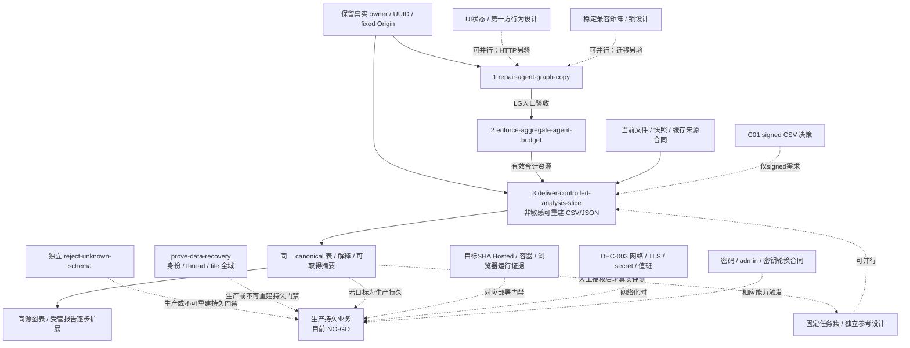

# Deep Data Agent Roadmap

> 当前决策：2026-10-27；固定 BASE：`main @ 3d4ac6dbb540d7f8a46430f3bc311c071d4ba438`。
> 本轮只交付文档，不实施候选、不改变后续候选的实施状态、不批准生产。历史验收在末节独立保留。

**实施更新（同日，修复工作树）**：首轮 `repair-agent-graph-copy` 已完成
源码修复与本机离线验收；新增复制回归 149 项、全量后端 601 项通过，
isort、发布契约与差异检查通过。新增部署阻断修复后继续
`enforce-aggregate-agent-budget`。
后续本机真实 TCP HTTP 补验通过，测试替身及 NumPy 初始化条件见
[补验记录](../specs/repair-agent-graph-copy/validation.md)。
代码提交 `8e552f3` 的 PR #1 四 Hosted Job 成功，Linux 验证由 Ubuntu Backend
和源码镜像 Container Smoke 分别取得；随后本机缓存依赖镜像与只读当前源码的
复制/TCP 回归 150 项通过。再从修复提交重建本机五服务，新镜像 150 项回归、
迁移和 Redis canary 通过，但实际工厂图退出发生身份 ContextVar reset 异常，
取消租约未及时释放；浏览器匿名入口/退出跳转丢失宿主端口，run 为 error。
本机完整联调未通过，资源已清理、PR 未合并；先独立修复下列新增部署阻断，
再继续合计预算，恢复等生产门禁保持。
本文件下文保留修复前的排序依据；2.1 的缺陷状态由本更新覆盖，实施记录见
[修复规格](../specs/repair-agent-graph-copy/spec.md)。

| 新增补验阻断 | 后续独立修复范围 | 完成条件 |
| --- | --- | --- |
| `repair-async-lease-context` | 已实施稳定 Task/Context、背压及释放保证 | 本机 619 项及精确部署依赖 Linux 194 项通过；随后新生产镜像的 wait/stream/取消/timeout 与浏览器 run 及实际 Redis 释放通过，见[部署重验](../specs/repair-static-auth-redirect/validation.md) |
| `repair-static-auth-redirect` | 已实施 Nginx 相对 Location 与真实 HTTP CI 门禁 | 当前源码生产静态构建、前端四门禁、五服务/浏览器通过；登录、退出与深链接保持 Origin/端口，正常 run 最终 success；条件见[本轮验收](../specs/repair-static-auth-redirect/validation.md) |

上述为本次验收发现后的候选，不增加固定 BASE 的 48 来源或改写 A/B 原值。
异步上下文已另立规格并实施，本机新增 17 项、全量 619 项与加严 HTTP 回归通过；
精确部署依赖 Linux 194 项及独立 Redis 实际释放通过。
2026-10-28 静态认证跳转已修，当前源码新镜像的五服务/浏览器、6 次租约释放、
两次 Redis 故障恢复和迁移 canary 均通过，本轮独立资源已清理。
前轮失败与任务 6、验收 18/19 的历史勾选保持；本轮未提交、未验 Hosted，
生产 NO-GO 保持。下一建议为合计预算，再接受控分析切片。

## 1. 方向与边界

2026-10-28 门禁工作树已实施合计账本、未知 schema 拒绝、三域停写恢复和
跨平台哈希锁。新锁 Windows 733 项回归、真实 Redis/TCP 20 个预算控制例、
真实 MySQL 20 个结构控制例通过。实施 SHA `1910fdf` 的 run `40635353761`
四 Hosted Job 全部成功；Linux 后端 733 项、新锁五服务、Chromium 七项及
三域独立恢复通过，恢复实测 31.757 秒、确认写入丢失 0、六项负控和非空目标
拒绝通过。最终文档提交自身精确 SHA 的结果由工作区根回执另行核对。证据见
[运行时验收](../specs/stabilize-delivery-baseline/validation.md)。
本机新锁镜像因系统盘保护中止；前轮镜像和浏览器证据保留原范围。
下文近期顺序为固定 BASE 的排序依据；下一产品候选为受控分析切片，
自动异地备份和生产运行时/真实效果仍需独立证据，生产 NO-GO 保持。

**保留现有架构，先修窄行为缺陷，再接通一个可验证的分析闭环。**
双入口、第一方 JWT/current role、默认拒绝、thread/run owner、受管 UUID 文件、
固定 Origin、Redis 恢复/租约、浅 readiness 和发布门禁继续作为基础。
当前事实、最终裁定、A/B 原值与技术资料见[项目分析](project_analysis.md#双维度裁定与追溯)；
不能以“48 个来源”解释为 48 个 bug，也不能以历史完成度解释为当前生产就绪。

复制及部署修复已在本机验收，接下来的建议顺序为 `enforce-aggregate-agent-budget` →
`deliver-controlled-analysis-slice`。后续实施另立 Spec，仍需对应任务授权。
UI 状态/行为、稳定兼容矩阵、离线评测设计可并行；未知 schema 拒绝可独立修。
不把依赖升级、IAM、恢复、图表、报告和平台建设打包成一次改造。

| 使用范围 | 不可绕过的进入条件 | 当前判断 |
| --- | --- | --- |
| 非敏感、可重建、隔离开发 | 真实 owner/文件边界、有效资源限制、来源可追溯、不自动外发；独立批准的假样本 | 可继续设计/离线开发；接入实际 Agent 前修正对应 copy/合计预算，不必等待生产恢复或全 IAM |
| 本机已安装组合的 LangGraph 主 run | A01 实际复制图可运行、身份/checkpoint/store/预算/cancel 保持；随后实际 HTTP/Linux 验收 | 复制、流退出与静态认证修复已在当前源码五服务/浏览器实证通过；合计预算及目标 SHA Hosted 另验 |
| 生产或不可重建持久业务 | 未知 schema 拒绝、身份/thread/checkpoint/file 一致恢复、目标部署 exact-SHA 运行证据；网络/密钥门禁按能力触发 | **NO-GO**；不以历史 Hosted、浅 ready、metadata 或本轮静态门禁放行 |
| 网络化、长期审计、HITL、任意执行 | 各自独立范围、责任人、数据/权限/保留合同及负控验收 | 未触发不建设；触发也不隐式扩大现有支持声明 |

本轮基线 Agent 实际于 2026-10-27 15:23–15:37 UTC+8 执行：
Python 3.12.9 的 pytest 452、迁移 8、release contract 159，以及 isort/发布契约/
唯一 head `b6f4e8c2a9d1`；已有缓存 Node 22.22.2/pnpm 10.5.1 四门禁、安全 Compose
静态解析与 diff 检查通过。它不是用户给定数字，也不是本文作者重跑。
默认 Node 25.2.1/pnpm 10.33.2 不符；Docker CLI/Compose/Desktop 有而 Linux Engine
pipe 缺，`gh` 缺。本 SHA Hosted/容器/浏览器、真实模型效果/费用/延迟和生产恢复未知，
详见[基线分层](project_analysis.md#基线与证据层次)。

## 2. 近期顺序

### 2.1 `repair-agent-graph-copy`

- **状态**：复制依赖与后续异步上下文、认证跳转独立修复完成；
  当前源码新生产镜像五服务/浏览器通过。以下保留原范围、依赖和停止条件。
- **单一目标与收益**：实际 API 复制后的图能运行，解除本机组合主 run 的条件可用性风险。
- **最小范围**：仅修 `ResourceBoundedAgentGraph` 的租约管理器重建/复制合同；
  保留 `CompiledStateGraph`、checkpoint/store 注入及四调用面，不换成一般 Runnable。
- **依赖与进入**：冻结已安装组合和 A01 重现条件；保持服务端 owner、当前角色和单 lease。
  本机 `copy`、`with_config`、API `get_graph` 丢 manager 的事实不外推 Linux/真实 HTTP。
- **验收**：原图、copy/update、with_config、get_graph 各自的 invoke/ainvoke/stream/astream
  可运行；双 owner、checkpoint/store、budget、超时/cancel 和一次释放均有正反例；
  模型/取 lease 前的 AttributeError 不再出现。目标平台/HTTP另取得实际证据。
- **停止**：必须绕过 owner、改变租约 scope、削弱 fail-closed，或扩成框架重写时停止。
- **归属**：REV-A01 独立；关联 AUD-006 的兼容债，但不能被其吞并。

### 2.2 `enforce-aggregate-agent-budget`

- **单一目标与收益**：同一 run 的模型/工具合计可解释且硬拒绝，为受控计算提供有效资源前置。
- **最小范围**：run-scoped、并发安全 ledger 覆盖 parent/inline child/summary/retry/tool；
  收紧 child recursion。只修计数/拒绝合同，不自动提高 8 模型/12 工具的批准限额。
- **依赖与进入**：LangGraph 入口验收依赖 2.1；ledger 离线设计可并行。
  身份、deadline、lease、取消和失败不缓存仍须保持。默认实证是 parent2+child8=10 model、
  child19+task1=20 tool、child recursion9999；summary limit1 实际2不是已满足限额。
- **验收**：第9次 model、第13次 tool 在执行前拒绝且无对应副作用；父子/摘要/重试/
  并行与双 owner 不漏账、不串账，拒绝/timeout/cancel 单释放，输出说明同实际 ledger。
  A/B 不同控制例、public/private 值不得混成一次探针，见[关键实证](project_analysis.md#关键实证反证与覆盖)。
- **停止**：竞争计数无法收敛、身份丢失、取消或释放失效、以扩大限额掩盖漏账时停止。
- **归属**：REV-A02；REV-R03 仅能力/预算分层证据。AUD-004 的同步 Redis 残余另归
  `isolate-async-redis-protection`，不重复计算同一合计预算缺陷。

### 2.3 `deliver-controlled-analysis-slice`

- **单一目标与收益**：一个 owner 的完整 CSV/JSON 得到一个可验证的确定结果，补齐预览之后的业务断点。
- **最小范围**：受管文件→完整结构/质量→一个人工批准的白名单指标→同一 canonical 结果表、
  解释和可取得摘要；图表只消费该结果，不另生成数值。逐步再扩受管图表/报告，不一次做 BI。
- **依赖与进入**：有效 owner/UUID/完整性/配额和 2.2 合计预算；LangGraph 执行还依赖 2.1。
  定义当前文件/历史快照及缓存依赖合同（A03/F07），而不是强行新增第四个近期必做修复。
  C01 只在 signed CSV 需求成立时触发；否则保留旧严格摄取或使用 JSON。
  非敏感可重建开发不等待全 IAM/生产 restore；不可重建持久业务按第3节门禁。
- **验收**：完整文件含超过20k预览的尾部对独立数值参考；列/类型/NA/duplicate/行数/
  范围/单位/精度/警告明确。表、解释、摘要与后续图使用相同参数、文件 UUID/SHA/版本、
  parser/tool/analysis 版本及结果 hash；用户实际取得同源结果。
  双 owner、引用失效/删除/过期/漂移、公式注入、超限、并发、timeout/cancel/重试均有负控，
  原始与派生产物按合同处理，不能由模型决定 owner。
- **停止**：需要任意代码/SQL、宿主路径、未授权外发、不可追溯来源、风险接受绕过
  owner/文件/资源，或验收必须读取真实业务数据时停止。
- **归属**：REV-R06、REV-R07 的首个业务切片；F06 是同源可视化验收面、F07 是生命周期合同。
  这些是机会/决策，不赋工程 P；后续扩展保留原 `deliver-data-analysis-reports` 方向。

## 3. 依赖与并行

下图为当前建议，**实线为相应能力验收硬依赖，虚线为条件门禁或可并行设计**。
三个近期实现按第2节顺序；离线 ledger/指标/测试设计可先行，不等于实际入口已验收。
UI、兼容和评测设计没有被画成前一项完成后才能启动的串行工作。

生产持久门禁不是开发队列里的第四个固定任务：一旦目标需要不可重建数据，必须提前安排
schema/restore，不能先接入再补。schema 拒绝本身无需等待完整恢复即可窄修。
恢复必须覆盖 MySQL 身份/REST 历史/file metadata、LangGraph 主 thread/checkpoint/store
及受管字节/版本；不能仅导出 MySQL，也不能以同容器 restart 或约10秒 flush 声称 RPO。
虚拟 state files 不是受管共享文件卷，两者恢复/删除验收不得相互替代。

身份治理按实际触发范围推进：密码错误、admin 并发和 JWT/active lease 轮换各自窄验，
不是所有离线非敏感统计的统一锁。真实模型比较、沙箱、MCP/Skills/memory/HITL 必须另规格、
人工批准和收益证据；不在本轮发模型、采购平台或默认启用。

## 4. 原八候选处置

原序号属于2026-08-21历史，不作为本轮排序；原 change-id 全部保留。
`adjust` 是拆小目标/修正依赖，`defer` 是有触发条件的延期，不等于删除。
不强行固定新的候选数量，不把下面28个具名子项都安排为近期必做。

| 原序 / change-id | 动作 | 当前单一主目标 / 最小范围 / 收益 | 真实依赖 / 验收 / 停止 |
| --- | --- | --- | --- |
| 1 `prove-data-recovery` | adjust | 保留一致恢复主目标，扩身份/thread/checkpoint/file metadata/bytes/version；schema拒绝独立窄修。防不可重建损失 | 分类/存储/RPO/RTO/专用环境；独立restore业务不变量、另一维护者复现；碰生产、备份不可恢复、未知仍stamp或无前向修复则停。不锁可重建统计开发 |
| 2 `stabilize-delivery-baseline` | adjust | 保留权威包/锁/受支持组合一致性；copy、UI行为、utils决策拆开，不混全升级。降低复现/兼容成本 | 完整发行/metadata/批准模块/DEC-005；干净Linux同锁两次、双入口/迁移/owner/stream回归；不可审计源、无owner入产物、未验就迁目标则停。与恢复/UI/评测设计可并行 |
| 3 `harden-identity-administration` | adjust | 保留身份边界，密码/admin事务/用途与lease轮换分别单目标验收；不扩OAuth/找回/管理UI | 旧账户/事务/密钥合同；byte/NUL非500、admin>=1、JWT滚动不拆lease；秘密入仓、用途复用或旧账户兼容不可证则停。不强依赖整套baseline，也非全分析前置 |
| 4 `paginate-session-history` | keep | 保留有界稳定owner分页，主threads继续加载/失败恢复优先，REST独立有界。用户取得完整历史 | DEC-001/cursor/sort；>100线程/大REST遍历、页限/索引/并发/失败恢复；弱owner、可识别cursor或无界兼容则停。不要求全baseline串行完成 |
| 5 `deliver-data-analysis-reports` | adjust | 保留方向，先第2.3节一个完整owner文件/一个确定指标/同源可取得结果，再扩图与报告。直接业务解锁 | owner/file/有效资源/当前或快照来源合同；独立数值参考、表图同源、越权/超界/cancel拒绝；来源不明、注入、失控、未授权数据则停。生产持久另需schema/restore |
| 6 `rewrite-credential-history` | defer | 人工协调历史清理或限期接受；不混普通业务改造 | 全部轮换、owner/协作者/refs/制品清单、干净树/冻结批准；目标refs与同步证据或责任/期限/补偿控制；未轮换、未知refs、脏树或未确认则停 |
| 7 `define-production-hosting-boundary` | defer | 部署目标未定先保留受控开发声明；触发时只先确定支持范围/防误暴露或独立生产Spec | owner/分类/网络/可用性目标；local-only绑定负控或TLS/secret/卷/备份/值班/回滚证据；无分类/责任或擅开公网则停。不先采购平台 |
| 8 `persist-compliance-audit-records` | defer | 无长期保留/合规需求不建平台；触发时仅审计完整性目标，避免给小分析增加平台成本 | 部署/事件白名单/保留/驻留/访问/独立密钥/预算；投递重放/授权/保留删除/restore完整性；正文/Token/原始身份、驻留或背压不可证则停 |

## 5. 映射与子迭代

下表是**28个具名条件/子迭代映射**，包括保留的恢复/分页 ID，不是28项新缺陷或固定计划。
每行只处理一个目标；是否启动由业务/部署条件和独立 Spec 批准决定。
原 ID 仍保留，合并 canonical 不丢证据；工程级别以分析文档最终裁定为准，机会不赋 P。

| 具名子迭代 / 原来源与归属 | 单一目标、最小范围与收益 | 依赖 / 可验证验收 | 停止条件 |
| --- | --- | --- | --- |
| `isolate-async-redis-protection` / AUD-004 | 租约/限流同步IO不阻塞timer/cancel；保留scope矩阵 | recovery/单lease；慢IO deadline/恢复/cancel单释放、失败不缓存 | 改fail-open/closed、无限线程/重试、租约失效 |
| `confirm-server-cancel` / REV-F01 | run ID和结果确认使Cancel状态真实，不混新UI功能 | SDK合同，A01解锁HTTP；creation/active/disconnect/switch/failure/retry全测 | 断流冒充已cancel、旧run串thread |
| `reconcile-tool-results` / REV-F02 | 按tool_call_id与真实状态补齐模型上下文 | F01/协议；multi/partial/乱序/fail/cancel不重复漏项或伪成功 | 必须伪造成功、兼容合同不明 |
| `preserve-edit-attachments` / REV-F03、F07编辑面 | 显式引用集合/移除，编辑不静默丢附件 | owner/checkpoint/失效；text+file/file-only/expired/deleted/fail/retry | 恢复Base64、跨owner、分支来源不明 |
| `verify-chat-workflows` / AUD-020 | 少量第一方离线组件/集成与关键E2E，证明真实workflow | fixed Origin/auth/stream/file，逐步纳F01-F03/B03/F07；本地/CI正反可复跑 | 非确定性失控、真实服务/秘密进CI |
| `validate-runtime-compatibility` / AUD-006分项REV-R02/R05 | 选一个可重复受支持稳定组合，不一次全升级 | 完整发行/依赖；锁/Linux/native/Auth/copy/stream/A01/A02双入口回归 | 资料不全称compatible/latest、转0.17rc或跳Linux证据 |
| `align-package-release-contract` / AUD-006分项REV-D02/D03/AUD-021；DEC-005输入 | 一个权威包/锁/资产合同，批准模块/hash/digest显式更新 | consumer/owner决策；仓外安装双入口/迁移/ready，同锁两次一致、漂移拒绝 | 未批准utils纳入、不可审计源、永久freeze |
| `reject-unknown-schema` / AUD-007 | stamp/DDL前完整指纹与稳定错误，防盲stamp | known legacy/脱敏四类MySQL；表列/类型/索引/FK/约束负控、DB不变、已知无损 | 未知仍stamp、生产数据或破坏性探测 |
| `prove-data-recovery` / RR-001、REV-D01 | 身份/thread/file全域一致恢复而非仅DB导出 | 分类/RPO/RTO/支持存储/专用备份；restart/recreate/crash、独立restore与另一维护者复现 | 无法恢复、跨owner、restart/flush冒充RPO |
| `recover-file-cleanup` / REV-B01 | tombstone+幂等对账使失败清理持久可重试 | owner/root/F07；unlink/commit前crash后重启定位、账实一致 | 误删活跃/别owner/根外字节 |
| `validate-file-storage-root` / REV-D04 | 默认与批准override根真正共享，写前拒挂载外值 | DEC-004/YAML；两入口默认/子路径/不兼容负控、recreate保留 | 仅marker、先写入才拒绝 |
| `expose-stable-cross-origin-errors` / REV-B03 | allowed浏览器能读稳定错误与request ID | fixed Origin/CORS顺序；400/413/429/503/预检正反 | 放宽Origin、丢ID或脱敏 |
| `validate-quota-isolation` / REV-B02 | 先两连接近配额实测RR/RC，不预设缺陷修复 | 专用非生产MySQL/时序；数量/字节/重复/过期/等待/重试矩阵 | 连生产、无隔离记录、SQLite代证 |
| `normalize-password-boundaries` / AUD-017 | 注册登录统一byte/NUL/error与旧hash迁移合同 | 旧账户批准策略；71/72/73/Unicode/NUL/4097非500、不后缀互认 | 静默破坏旧账户或只改注册 |
| `preserve-admin-continuity` / AUD-016 | 锁内actor和admin>=1事务不变量 | 专用MySQL两连接；交叉降级最多一成功、陈旧actor/死锁/重试、bootstrap保留 | 零admin可提交、陈旧权限可变更 |
| `separate-identity-digests` / AUD-012/018 | audit/lease/限流各独立用途与key，轮换连续 | 密钥/滚动合同；JWT不拆active lease/审计归属、窗口不漂移，无key不枚举 | secret入仓、用途复用、活跃分组漂移 |
| `paginate-session-history` / AUD-010、追溯AUD-013 | 稳定owner分页；主thread优先、REST独立有界 | DEC-001/cursor/sort/索引；超页/并发/伪过期游标/失败恢复 | 无界兼容、弱owner、身份游标 |
| `decide-file-answer-semantics` / REV-A03/F07主归属 | 只定当前文件或历史快照及liveness，最小缓存依赖/状态声明 | owner/UUID/SHA/expiry；active/delete/expiry/hash/cache/普通query、refresh/switch/logout/upload/sendfail/retry | REST叫主ChatUI泄漏、强抹授权旧文本、当前合同绕读取复核 |
| `strengthen-critical-contracts` / REV-D05 | 关键marker由窄结构/行为负控补强，减少错层盲区 | Agent栈/卷合同；注释/死码/未注册/错层仍有marker也失败 | 全scanner重写、否认已有行为测试 |
| `align-supported-frontend-guidance` / REV-F05 | 唯一当前支持指南与旧脚本边界 | consumer/DEC-005/static basepath；另一维护者可复现、不误导旧表单/代理 | 全树权限修改、静默删外部消费者 |
| `patch-exposed-frontend-runtime` / REV-R01 | 只对适用static/server模式补丁 | 当时公告/稳定目标/lock；静态四门禁/Nginx深链及相关server回归 | server CVE套Nginx、floor称latest、盲跳major |
| `extend-canonical-analysis-output` / REV-R07后续、F06 | 同源result扩图与受管报告，不多套数值链 | R06/F07；持久目标RR-001；table/chart/download同值/单位/范围/来源/删除 | 模型决定owner、来源缺失、派生删除漏项 |
| `establish-analysis-evaluation` / REV-R08 | 固定任务集/hash/独立参考/失败分类；设计先并行 | 任务/版本合同；真实模型另人工批准后才填success/latency/calls/retry/token/bill | 自动发模型、pytest当真实成功率、编造cost |
| `decide-signed-csv-contract` / REV-C01 | 无需求保旧策略，有需求只批准finite数值grammar | 业务/安全Spec；长度/指数/精度/公式/空白/quoted/整批正反、导出转义 | 摄取改值、危险表达式、无Spec改策略 |
| `activate-inbox-safely` / REV-F04 | HITL需求成立才定义accepted/error/finish合同 | 真实schema/SDK；单/批/失败保留/幂等retry/cancel | 默认未启用当主聊天bug、仅await当成功 |
| `compare-model-protocol` / REV-R04 | 一次一个协议/效果对照，现baseline保留 | R08/人工批准；reasoning+多轮tool回传/stream/error/usage/实测正确性耗时 | 只改模型名、自动发模型/扩预算 |
| `trial-isolated-execution` / REV-R09 | 延期；白名单不足且收益明确才独立隔离试验 | 独立Spec/RR-004重评；无host/socket/secret/network、CPU/memory/disk/time/TTL/cancel/逃逸/owner负控 | 恢复任意Python/host shell/socket或秘密 |
| `trial-one-agent-capability` / REV-R10 | 延期；每次一项Todo/Skills/MCP/专用agent/memory收益 | R08/A02/owner-network-retention；同taskset、可回退 | 无收益默认成套启用/采购 |

### 完成项与别名

| 原来源 | 唯一当前归属 | 保留验收或追溯 |
| --- | --- | --- |
| AUD-014/011/015 | 已完成 `restore-runtime-release-gates` 的回归 | 镜像迁移资产/current-source五服务/exact-SHA四Job/失败清理/跟踪及非忽略文本脱敏canary；本轮无Engine/gh不重开机制缺失 |
| AUD-001/003 | 已完成 `secure-agent-tenant-boundaries` 的回归 | 两入口匿名/双owner/admin/thread/run/history/state/copy/cache拒绝；fixed Origin/401/logout/403合同；升级继续保持 |
| AUD-002/005 | 已完成 `isolate-file-ingestion` 的回归 | UUID/隐藏主体/root/非symlink/普通文件/size/SHA/配额；选择拖放粘贴超界整批无副作用 |
| AUD-008/009 | 已完成 `bound-agent-resource-use` 的回归 | Redis单飞恢复/分级策略、live/ready浅检查/恢复/无付费探针；同步IO残余与A02另列 |
| REV-A01/A02、REV-R06/R07首面、REV-R03 | 第2节前三项 | A01独立，R03→A02不增缺陷；R06/R07为业务机会，R07后续图/报告面映射上表 |
| REV-D02/D03/R02/R05、追溯AUD-021 | AUD-006 | 分项全保留，不重计供应链根因；package/compatibility子迭代各窄验 |
| REV-D01、REV-D06 | 分别 RR-001、DEC-005 | 恢复/consumer主归属不另造重复风险或决策 |
| AUD-013、AUD-019 | 分别 AUD-010、null/excluded | 分页合并；AUD-019不创建修复，部署范围归RR-003/DEC-003；旧0/2与本轮支持排除是不同维度 |

正式 `AUD-001` 与 raw `AUD001` 是别名，REV保留原编号。
48主来源加3追溯的原七字段102票、理由/反证和最终状态均在
[独立原值](project_analysis.md#独立原值)；本表只规划后续，不改 raw 或历史等级。
AUD-004 保留原 async 修复，但完整closed不成立；同步Redis残余P2不排除，
合计预算唯一归A02。A03只涉及REST TTL86400回答cache的当前/快照合同，不能称主ChatUI泄漏。

## 6. 风险决策

每个 RR/DEC 只设一个主 change-id；子项/关联验收不是新增主映射。
所有风险接受须有责任人、理由、范围、补偿控制、期限和复审触发；
不能接受真实 owner/文件/资源边界失效来绕过接入门禁。

| ID | 当前主归属 | 状态、触发与验收边界 |
| --- | --- | --- |
| RR-001 | `prove-data-recovery` | 开放；生产/不可重建持久目标提前触发，全域独立restore与RPO/RTO；REV-D01归此，不锁隔离可重建开发 |
| RR-002 | `rewrite-credential-history` | 延期；全部凭据轮换失效，公开/合规/协作条件触发人工重写或限期接受；现树扫描不等历史清零 |
| RR-003 | `define-production-hosting-boundary` | 延期；任何正式网络/生产目标先定范围、防误暴露、TLS/secret/备份/值班；local-only不能只靠一句声明 |
| RR-004 | 已完成 `bound-agent-resource-use` | 任意Python从runtime/公共配置删除，保持收口；未来沙箱独立Spec重评，不恢复旧开关 |
| RR-005 | `persist-compliance-audit-records` | 延期；长期保留/合规才触发，事件白名单/授权/驻留/删除/完整性/恢复与成本有界；本地日志非长期审计 |
| RR-006 | 已完成 `bound-agent-resource-use` | Redis分级fail-open/closed、单飞1..30秒退避恢复保留；AUD-004异步IO改造不得改scope |
| DEC-001 | 已完成 `secure-agent-tenant-boundaries` | LG主thread/checkpoint/store、MySQL身份及保留REST历史，不双写主聊天；分页/恢复必须遵守 |
| DEC-002 | 已完成 `secure-agent-tenant-boundaries` | 自定义Auth/当前角色/服务端owner与fixed Origin；不新增REST流式代理来绕copy |
| DEC-003 | `define-production-hosting-boundary` | 开放；决定严格local-only或受支持网络部署，后者另生产Spec，未定不采购/开放公网 |
| DEC-004 | 已完成 `isolate-file-ingestion` | MySQL owner metadata+受管共享卷+opaque UUID；仅批准严格文本格式，不混虚拟state file |
| DEC-005 | `stabilize-delivery-baseline` | 开放；先consumer/owner盘点再批准utils独立治理或隔离/归档；无owner不进镜像，结果输入package子迭代与F05 |

## 7. 验收与停止

每个候选须人工触发并另建 Spec，单目标、最小范围、明确非目标、实证正反与失败清理。
实现完成后分别记录源码、安装组合、离线、目标平台运行和真实业务效果；不互相代替。
本轮技术资料的获取日/来源日/适用版本/单源冲突见
[17组来源](project_analysis.md#技术资料与现代化选择)，不重新搜索、不把metadata候选称兼容结论。
API稳定候选先补完整资料与Linux验收，不迁0.17rc；drain是0.17rc+graph>=1.2.15且
handoff适用Postgres的特定条件，不能写成graph>=1.2均有。Python3.12/Node22可保持major，
patch/digest随批准资料显式更新，不伪造新patch发行或永久freeze。
Next维护表与发布时间加两年的期限冲突保留；React后续修复floor不是latest，
server/RSC漏洞不套Nginx静态部署。模型thinking新协议不是现baseline失效的证据。

- 出现真实凭据、跨owner、未经授权文件读取、不可恢复数据变化、无法取消的高成本执行、
  敏感日志/外发或来源伪造，立即停止对应迭代并恢复安全门禁。
- 硬前置回归锁定其消费能力；schema/restore锁定相应生产持久目标，不扩大为全开发锁。
- 优先级/依赖/支持范围/风险接受变化必须同步独立Spec、正式文档和变更记录，不由实现隐式决定。
- 真实模型/搜索、生产恢复、Git历史重写和网络开放只由授权人员人工触发；
  记录版本、时间、结果和错误分类，不保存敏感原文。
- 文档完成不等于代码修复、当前SHA运行成功、真实分析效果或生产放行；本轮不勾tasks/checklist。

## 8. 历史里程碑

**以下是冻结历史，不是2026-10-27现状全文。** 固定BASE两旧文档的原标题/原等级、
矩阵、里程碑和验收边界分别在本节与[历史冻结区](project_analysis.md#历史冻结区)保留。
块内“当前工作树”“下一候选”“关闭”“分析锁定”均指2026-08-21历史；本轮调整在第1–7节。
历史10关闭/8开放、0P0/1P1/6P2/1P3及生产NO-GO不能直接成为本轮统计。
原18项的本轮状态另列于分析：9保持源码关闭、原8开放、AUD-004部分修复/同步Redis残余。

来源 BASE blob `42758d4ca34630824f945427dcfe715c88f8e3a0`，
[固定历史全文](https://github.com/jwj911/deep_data_agent/blob/3d4ac6dbb540d7f8a46430f3bc311c071d4ba438/.trae/documents/roadmap.md)；
以下六块原文仅规范行尾，SHA-256分别为：

| BASE原范围 / 冻结标识 | SHA-256 |
| --- | --- |
| L26–L40 / RM-MILESTONES | `6299c7b1f82904bf175a33c8f3a24e90ef3b3a57f78ac0e87975dd1ef2f73228` |
| L103–L122 / RM-RESTORE | `7aece21af07f61e69c61046ce7142002c1cf5e66944e71b21f73c1662dfb82cc` |
| L147–L180 / RM-TENANT | `43adca8a6e43f0d706a54dfc5597ecdeac75a91c3dba200d63b3eb466c13a051` |
| L182–L212 / RM-FILE | `941fdb2d9f204dff41293fa8d8edc33bcec5395567e5ab579c559555d1fcb8e8` |
| L214–L252 / RM-BUDGET | `2c07a75c072a5dc3322bce3734b228526ab0886996d5a4ff0f0a6e6dca86f5c3` |
| L408–L442 / RM-AUD-MAPPING | `8e61b46ccbae6c59d080213f937158390551b5f8df259f638e025ab05cabb417` |

另已完成历史 `audit-project-roadmap`：执行日2026-08-12，2026-08-16同运行时代码基线
18/18均2/2复核、只收紧证据；状态日2026-08-21，基线
`f6cf4e65d8b15114fc164fd6921bd65d6ad27862`。收口只改5个治理文档与audit规格，
无runtime/tests/deps/config改动。这是11功能+1audit，不把modernization算第12功能。

四组Hosted都是原implementation SHA，不是最终验收文档SHA。原记录未给出的早期Job ID/
精确时间/最终文档SHA/run继续保持当时未知，不能以BASE或后来记录补造。
最后一组原记录的最终文档exact-SHA四Job门槛完整保留；本轮BASE的Hosted状态另为未知。

<!-- BEGIN RM-MILESTONES -->
## 2. 已完成的 11 个 change-id

| 顺序 | change-id | 里程碑 | 主要边界 | 状态 |
| --- | --- | --- | --- | --- |
| 1 | `establish-runnable-baseline` | 建立可运行闭环 | 拆分 FastAPI/LangGraph 入口，建立五服务 Compose、缓存降级和默认关闭代码执行的基线 | 已完成 |
| 2 | `secure-user-sessions` | 第一方认证与会话隔离 | JWT、CORS、浏览器登录态及会话/消息所有权默认隔离 | 已完成 |
| 3 | `enforce-release-readiness` | 建立发布就绪治理 | 后端、前端、发布契约 Hosted CI 与本地发布检查 | 已完成 |
| 4 | `add-observability-diagnostics` | 增加可观测性与发布诊断 | 请求关联、UTC 结构化脱敏事件、有界日志和人工诊断导出 | 已完成 |
| 5 | `add-request-rate-limiting` | 增加请求限流与资源保护 | FastAPI 身份维度固定窗口限流，Redis 故障时受观测地 fail-open | 已完成 |
| 6 | `add-versioned-migrations` | 增加版本化数据库迁移 | Alembic 单 head、全新库 upgrade、旧库 stamp 与 schema 漂移测试 | 已完成 |
| 7 | `add-rbac-audit` | 增加 RBAC 与脱敏审计 | 固定 `user`/`admin` 角色、双层默认拒绝、人工管理员引导和 HMAC 身份引用 | 已完成 |
| 8 | `restore-runtime-release-gates` | 恢复运行时发布门禁 | 镜像迁移资产、全 Git 文本凭据扫描、本地五服务/迁移冒烟和 Hosted Container Smoke | 已完成（本地与 Hosted 证据） |
| 9 | `secure-agent-tenant-boundaries` | 保护 Agent 租户边界 | 第一方 JWT 贯穿 FastAPI/LangGraph，thread/run owner、租户缓存和固定浏览器 Origin | 已完成（本地与 Hosted 证据） |
| 10 | `isolate-file-ingestion` | 隔离文件摄取 | owner 受管 UUID 文件、格式/配额/保留、无任意路径和无新 Base64 thread | 已完成（本地与 Hosted 证据） |
| 11 | `bound-agent-resource-use` | 约束 Agent 资源使用 | Agent/模型/工具预算、Redis 恢复与策略矩阵、分层健康、删除任意 Python 执行 | 已完成（本地与 Hosted 证据） |
<!-- END RM-MILESTONES -->

<!-- BEGIN RM-RESTORE -->
### 5.1 `restore-runtime-release-gates`

- **状态**：已完成（本地与 Hosted 证据）；不再计入 8 个候选。
- **结果**：恢复当前源码镜像的迁移可启动性，并让 CI 与凭据门禁能够阻止同类
  镜像缺件或凭据扫描盲区回归进入主分支。
- **映射**：`AUD-014`（P0，当前镜像运行资产不完整）、`AUD-011`（P2，CI 缺少
  镜像运行证据）、`AUD-015`（P2，凭据扫描范围存在盲区），三项均由当前工作树
  关闭。
- **本地证据**：Python 3.12.9 共 189 项测试，其中迁移定向测试 7 项；Node.js
  22.22.2、pnpm 10.5.1 前端四门禁通过。当前源码镜像的五服务、三个非业务 HTTP、
  唯一 head、head canary 和已知旧基线升级均通过，旧基线角色回填为 `user`。
- **Hosted 证据**：implementation SHA
  `30e7992fa48c350a0b0ae8a6faa12c80cfe2202d` 的 GitHub Actions run
  `31959537002` 为 `completed/success`；Backend、Frontend、Release Contracts、
  Container Smoke 四个 Job 均为 `success`，Container Smoke 的空库、head 重启、
  legacy 升级和 cleanup 均为 `success`。
- **安全与清理**：只使用专用假配置和不可外连的模型地址，未发送业务查询或调用
  外部模型/搜索；容器、网络、匿名卷、临时配置及生成物完整清理。
- **保留边界**：不关闭 `AUD-006`、`AUD-007`，不部署生产、不重写 Git 历史；
  Hosted 成功不扩大上述边界。
<!-- END RM-RESTORE -->

<!-- BEGIN RM-TENANT -->
### 5.3 `secure-agent-tenant-boundaries`

- **状态**：已完成本地与 Hosted 验收；不再计入 8 个候选。
- **目标**：让第一方身份贯穿 FastAPI Agent 入口、LangGraph run/thread、缓存和
  浏览器连接，阻止匿名调用、跨租户线程访问及 Key 被发送到非信任地址。
- **映射**：`AUD-001`（P0，Agent/LangGraph 多租户边界缺失）、`AUD-003`
  （P0，浏览器 LangGraph 地址与 API Key 信任边界不足）、`DEC-001`（MySQL 会话消息与
  LangGraph threads 的对话主数据源决策）、`DEC-002`（同源代理、自定义认证或
  独立网关的 LangGraph 入口决策）。
- **依赖**：`restore-runtime-release-gates`；既有认证、RBAC、限流和请求关联能力。
- **决策**：`DEC-001` 已选择 LangGraph threads 为 Chat UI 对话主数据、MySQL
  users/RBAC 为身份主数据且不双写；`DEC-002` 已选择当前版本自定义 Auth，不新增
  FastAPI 流式代理。
- **结果**：第一方 JWT 同时保护 FastAPI `/api/query` 与 LangGraph；thread/run
  owner 由服务端覆盖并过滤，管理员不绕过；Agent 缓存按用户、模型和工具策略
  隔离；前端只连接构建配置，删除旧 LangGraph API Key 读写。
- **本地证据**：Python 3.12.9 下 250 项测试；Node 22/pnpm 10.5.1 的 typecheck、
  零警告 lint、format:check；五服务空库双用户、head 重启和 legacy 升级三场景
  通过。双用户场景覆盖固定 assistant、并发重复搜索、history/state/copy/读改删/
  create_run、管理员不绕过和无 MySQL 双写；全程未调用模型或搜索。
- **Hosted 证据**：implementation SHA
  `9699f90f6fd2a90d63d82728208fb656cb4fe8e3` 的 run `31994602064` 为
  `completed/success`；Backend、Frontend、Release Contracts、Container Smoke
  四个 Job 及空库双用户、head 重启、legacy 升级、cleanup 均成功。
- **依赖风险**：容器中的 `langgraph-api 0.7.28` 已 EOL，升级与兼容回归归入
  `AUD-006`/`stabilize-delivery-baseline`。
- **非目标**：不引入组织层级、自定义角色、计费、多区域租户或第三方 SSO；不在
  本轮开放数据分析。
- **验收门槛**：匿名 Agent 请求稳定拒绝；两个用户不能搜索、读取、继续、删除或
  复用对方 thread/run/cache；管理员默认也不能绕过所有权；恶意 `apiUrl`、查询
  参数、重定向和 origin 不能接收 Key；并发及重试测试不混淆租户，日志不记录
  principal 原文、Key 或消息正文。
- **停止条件**：任何跨租户读写、Key 外发、无法归属的历史 thread，或为兼容旧
  客户端而保留匿名旁路时停止，后续文件与执行迭代不得开始。
<!-- END RM-TENANT -->

<!-- BEGIN RM-FILE -->
### 5.4 `isolate-file-ingestion`

- **状态**：已完成本地与 Hosted 验收；不再计入 8 个候选。
- **目标**：以租户所有的受管理上传替代任意本地路径读取，并对文件类型、大小、
  生命周期和解析行为实施服务端限制。
- **映射**：`AUD-002`（P0，文档工具可读取任意可见路径）、`AUD-005`（P2，上传
  仅有客户端类型检查且缺少大小边界）、`DEC-004`（禁用路径工具或建设受管理上传
  的决策）。
- **依赖**：`secure-agent-tenant-boundaries`；可与
  `bound-agent-resource-use` 并行。
- **决策**：`DEC-004` 选择 MySQL owner metadata + 受管共享卷 + opaque UUID；
  首期只允许严格 UTF-8 TXT/Markdown/CSV/JSON，不开放 PDF、Office、压缩包、
  图片、OCR 或病毒扫描。
- **结果**：上传体、文件/批次/用户配额、CSV/JSON 内容、保留和整批事务由服务端
  强制；`analyze_document` 只接受 UUID 并使用隐藏认证主体；前端只向 thread 写
  小型引用，不再生成新 Base64。
- **本地证据**：Python 3.12.9 下 295 项测试、迁移定向 8 项和全部静态门禁通过；
  Node 22/pnpm 10.5.1 四门禁通过，Google Fonts 网络依赖已移除。五服务空库双用户、
  head 重启、legacy 升级通过；无凭据 Chromium mock 验证附件预览/删除。
- **Hosted 证据**：implementation SHA
  `9fe0c40bd66a01db427fe37169a0ec0f65f24f85` 的 run `32008059164` 为
  `completed/success`；Backend、Frontend、Release Contracts、Container Smoke
  四个 Job 及空库双用户、head 重启、legacy 升级、cleanup 均成功。
- **非目标**：不读取用户提供的服务器绝对路径；不支持任意文件格式、永久文档库、
  OCR/病毒平台或跨租户共享；不自动把真实业务文件发送给模型。
- **验收门槛**：越权文件 ID、路径穿越、符号链接、伪造 MIME、超限文件、压缩炸弹
  和公式注入均 fail-closed；两个租户的上传、解析、删除和产物完全隔离；中断/
  超时后临时文件可回收；禁用解析器时原文件仍不可被 Agent 直接读取；测试与日志
  只使用脱敏样本。
- **停止条件**：解析器需要宿主机任意文件权限、文件无法关联租户、删除无法覆盖
  派生产物，或任一恶意样本造成进程失控时停止。
<!-- END RM-FILE -->

<!-- BEGIN RM-BUDGET -->
### 5.5 `bound-agent-resource-use`

- **状态**：已完成本地与 implementation Hosted 验收；不再计入 8 个候选。
- **目标**：为 Agent、模型与工具建立端到端预算，恢复 Redis 故障后的受控行为，
  并让健康端点反映真实的存活/就绪状态。
- **映射**：`AUD-004`（P1，Agent/工具缺少完整执行预算）、`AUD-008`（P1，Redis
  故障后降级与恢复边界不足）、`AUD-009`（P2，健康检查不反映关键依赖/配置）、
  `RR-004`（任意 Python 执行无沙箱）、`RR-006`（Redis 故障策略）均由当前
  工作树收口。
- **依赖**：`secure-agent-tenant-boundaries`、`isolate-file-ingestion`，均已
  满足；与下一候选 `prove-data-recovery` 无互相阻塞依赖。
- **结果**：FastAPI/LangGraph 共用 recursion 25、模型调用 8 次、工具调用 12 次
  和 Redis 全局 4/用户 1 租约；FastAPI 执行 8,000 字符输入、32,000 字符输出和
  60 秒总 deadline。ChatOpenAI 固定 45 秒/1 retry/4,096 tokens；搜索固定
  2,000 字符/5 条/15 秒/64 KiB，只保留 general/news。
- **Redis 与健康**：缓存及 auth/session/default 限流 fail-open，query 限流、
  Agent 租约和 readiness fail-closed；1..30 秒单飞指数退避可无重启恢复。
  `/api/live` 与兼容 `/api/health` 只证明进程存活，`/api/ready` 浅检查固定组件，
  Compose 与 Container Smoke 使用 readiness。
- **BREAKING**：任意 Python 执行工具及 `ENABLE_CODE_EXECUTION`、Compose、提示和
  注册路径已删除；残留变量不能恢复。搜索不再暴露 raw content 或
  images/videos/files topic。
- **本地证据**：Python 3.12.9 全量 452 项、迁移 8 项、release contract pytest
  159 项通过；isort、发布契约脚本、Alembic 唯一 head、Compose 与差异检查通过。
  Node.js 22.22.2、pnpm 10.5.1 的 typecheck、零警告 lint、format:check、build
  通过。Docker Engine 29.4.1、Desktop 4.71.0、Compose 5.1.3 下 empty/head/
  legacy 与 Redis canary 全部通过；模型/搜索调用为 0，资源已清理。
- **Hosted 证据**：implementation SHA
  `1090c3ea0954e84cc2cb6b945ef8c3913393cec8` 的 run `32431502248`
  （2026-08-21T00:08:27Z..00:11:51Z）为 `completed/success`；Backend
  `96623829169`、Frontend `96623829344`、Release Contracts `96623829444`、
  Container Smoke `96623829378` 均为 `success`。
- **最终文档门禁**：最终验收文档提交只有在其自身 exact SHA 的同四个 Hosted
  Job 全部成功后才成立。创建本记录时该 SHA 与 run ID 尚未知，不记录推测值，
  也不能以 implementation run 替代。
- **非目标**：不建设通用容器编排平台、分布式调度器、自动封禁系统或无限重试；
  不恢复半成品代码沙箱，不以 readiness 代替外部监控、SLO 或生产容量验证。
- **保留边界**：`AUD-007`、`RR-001`、`AUD-006` 等剩余风险不由本轮关闭；生产
  仍为 NO-GO，数据分析能力继续受恢复前置锁定。
<!-- END RM-BUDGET -->

<!-- BEGIN RM-AUD-MAPPING -->
## 8. 审计问题状态与 Roadmap 唯一映射

### 8.1 当前工作树已关闭

| 审计 ID | Spec 最终 severity | 完成 change-id | 当前状态 |
| --- | --- | --- | --- |
| `AUD-014` | `P0` | `restore-runtime-release-gates` | 镜像迁移资产及空库/head/已知旧基线本地容器证据通过，已关闭 |
| `AUD-011` | `P2` | `restore-runtime-release-gates` | Container Smoke 工作流、本地五服务及 Hosted run `31959537002` 证据完成，已关闭 |
| `AUD-015` | `P2` | `restore-runtime-release-gates` | Git 跟踪及非忽略待提交文本扫描、二进制与脱敏测试通过，已关闭 |
| `AUD-001` | `P0` | `secure-agent-tenant-boundaries` | FastAPI/LangGraph 第一方身份、thread/run owner 与租户缓存已由双用户容器实证关闭 |
| `AUD-003` | `P0` | `secure-agent-tenant-boundaries` | 前端固定 Agent Origin、移除持久化 API Key 并增加发布契约，已关闭 |
| `AUD-002` | `P0` | `isolate-file-ingestion` | 任意路径工具已改为认证主体 + owner UUID，路径/符号链接/漂移测试通过，已关闭 |
| `AUD-005` | `P2` | `isolate-file-ingestion` | 服务端格式/请求体/配额/保留与无 Base64 引用链完成，已关闭 |
| `AUD-004` | `P1` | `bound-agent-resource-use` | Agent/模型/工具、deadline、输入/输出和双层租约预算由本地代码、测试、容器与 Hosted 证据关闭 |
| `AUD-008` | `P1` | `bound-agent-resource-use` | Redis 单飞退避、自动恢复和 fail-open/fail-closed 矩阵由本地故障注入、canary 与 Hosted 证据关闭 |
| `AUD-009` | `P2` | `bound-agent-resource-use` | liveness/readiness 拆分、固定组件浅检查和 Compose 健康契约由本地与 Hosted 证据关闭 |

### 8.2 当前开放 8 项

| 审计 ID | Spec 最终 severity | Roadmap change-id | 处置 |
| --- | --- | --- | --- |
| `AUD-007` | `P1` | `prove-data-recovery` | 用 MySQL 证明迁移保护、备份和恢复 |
| `AUD-006` | `P2` | `stabilize-delivery-baseline` | 锁定 Python 依赖、包元数据、执行契约及镜像/Actions；`AUD-021` 已并入 `AUD-006` |
| `AUD-020` | `P2` | `stabilize-delivery-baseline` | 增加前端关键工作流行为测试 |
| `AUD-017` | `P2` | `harden-identity-administration` | 收紧密码字节、编码和哈希错误边界 |
| `AUD-016` | `P2` | `harden-identity-administration` | 保证管理员连续性和角色变更不变量 |
| `AUD-012` | `P2` | `harden-identity-administration` | 分离 JWT 签名与审计身份引用密钥 |
| `AUD-010` | `P2` | `paginate-session-history` | 为会话、消息与前端线程增加完整分页；原 `AUD-013` 作为同一分页根因合并到 `AUD-010` |
| `AUD-018` | `P3` | `harden-identity-administration` | 以独立可轮换 HMAC 替代可枚举的低熵限流 SHA-256 摘要 |

原 `AUD-013`（前端线程分页）作为同一分页根因合并到 `AUD-010`，统一归属
`paginate-session-history`；`AUD-021` 已并入 `AUD-006`，二者不重复计数。仅
`AUD-019` 经双重验证为 0/2 并排除，不创建 Roadmap 工作。第 8.1 节 10 项与第
8.2 节 8 项共同保留历史 18 项的唯一映射；当前开放统计为
**0 P0 / 1 P1 / 6 P2 / 1 P3**。
<!-- END RM-AUD-MAPPING -->
